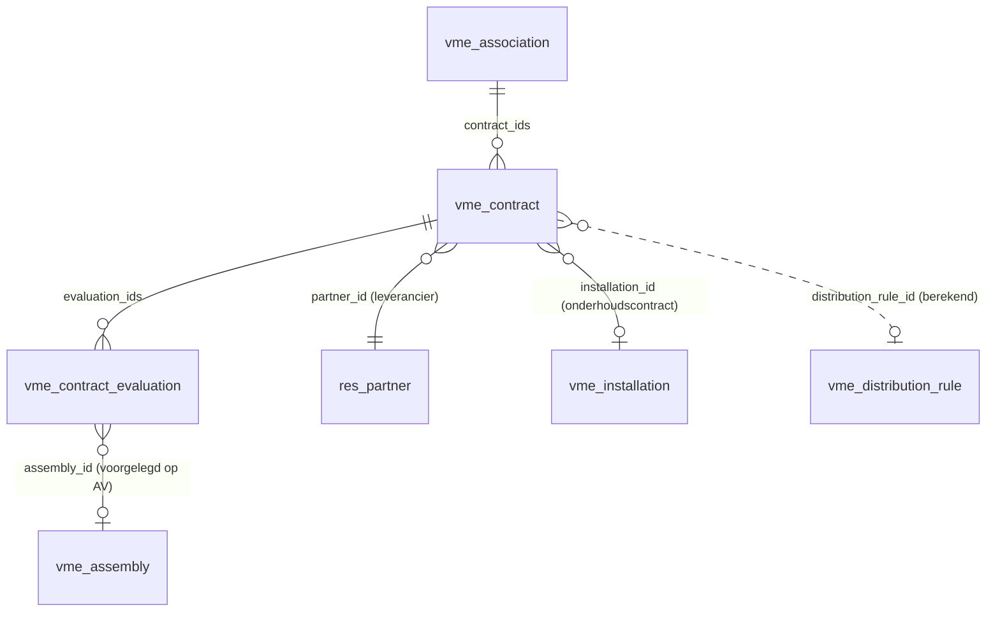

# Contracten en personeel (stap 18)

## Modellen (`addons/vme_belgie/models/vme_contract.py`)



- **`vme.contract`** (`mail.thread`, `mail.activity.mixin`):
  - `contract_type`: onderhoud, schoonmaak, verzekering, energie, lift, conciërge en personeel, andere
  - `state`: lopend, opgezegd, beëindigd
  - Looptijd: `date_start`, `date_end` (laatste dag van de lopende periode, leeg = onbepaalde duur), `auto_renew`, `renewal_months`
  - `notice_period_months`: opgeslagen compute met standaard per soort uit `DEFAULT_NOTICE_MONTHS`. Zoals de keuringsfrequentie wordt hij alleen ingevuld als hij leeg is.
  - `notice_deadline` (opgeslagen) en `notice_state` (niet opgeslagen, hangt af van vandaag; alleen voor lopende contracten)
  - `last_evaluation_date` en `next_evaluation_date` (opgeslagen): laatste evaluatie + 12 maanden, zonder evaluatie de begindatum + 12 maanden
  - Niet opgeslagen: `distribution_rule_id`, `distribution_key_id`, `distribution_account_id` via `vme.distribution.rule._find_rule()`, en `billed_this_year` (geboekte aankoopfacturen en creditnota's van de commerciële partner in de company sinds 1 januari)
  - `activity_notice_deadline` en `activity_evaluation_date` onthouden voor welke datum er al een taak is
- **`vme.contract.evaluation`**: datum, beoordeling, voorstel (verderzetten, heronderhandelen, nieuwe offertes, opzeggen), optioneel de AV waarop ze voorgelegd werd, toelichting.
- **`vme.installation`** krijgt `contract_ids` en de berekende velden `maintenance_contract_id` (het lopende contract met de vroegste einddatum) en `maintenance_contract_end`. De oude velden `maintenance_contract_ref` en `maintenance_contract_end` zijn weg (zie Migratie).
- **`vme.association`** krijgt `contract_ids`. Het tabblad *Contracten* op het VME-formulier komt uit een geërfde view (`vme_association_view_form_contracts`).

De wettelijke standaarden staan bovenaan het bestand, elk met `# LEGAL-CHECK:`: de opzeg van een verzekering, de opzeg van energie, de arbeidsovereenkomst en de evaluatieplicht van de syndicus.

## Opzegtermijn berekenen

`notice_deadline(period_end, months)` rekent terug vanaf de dag waarop de volgende periode zou beginnen, niet vanaf de einddatum zelf:

```
deadline = (period_end + 1 dag) - months - 1 dag
```

Zo blijven periodes die op het einde van een maand stoppen op het einde van een maand:

| Einde periode | Opzegtermijn | Uiterlijk opzeggen op | Naïef (`period_end - months`) |
| --- | --- | --- | --- |
| 31/03/2027 | 3 maanden | 31/12/2026 | 31/12/2026 |
| 28/02/2027 | 3 maanden | 30/11/2026 | 28/11/2026 |
| 30/06/2027 | 6 maanden | 31/12/2026 | 30/12/2026 |

`add_months_to_period_end()` gebruikt dezelfde regel voor de verlenging: een periode tot 28/02/2027 die een jaar verlengd wordt, loopt tot 29/02/2028.

De opzeg moet **ontvangen** zijn op die datum. Voor een aangetekende brief rekent de medewerker zelf de verzendtijd erbij. De taak komt 60 dagen vooraf, dus daar is ruim tijd voor.

## Cron

`ir_cron_vme_contract_activities` draait dagelijks `vme.contract._cron_schedule_contract_activities()`. Die doet drie dingen:

1. **Verlopen contracten** (`_roll_over_expired_contracts`): een lopend contract met `date_end` vóór vandaag en stilzwijgende verlenging schuift met `renewal_months` op tot de periode vandaag weer bevat (ook als de cron lang niet gedraaid heeft), met een bericht in de chatter. Zonder verlenging, of als het opgezegd is, wordt het *beëindigd*.
2. **Opzegtermijnen**: voor elk lopend contract met een `notice_deadline` tussen vandaag en vandaag + `NOTICE_LEAD_DAYS` (60) komt er één to-do met die datum als vervaldatum. Een verstreken termijn krijgt geen taak meer: dan is het te laat, en na de verlenging volgt de volgende termijn.
3. **Evaluaties**: voor elk lopend contract met `next_evaluation_date` binnen `EVALUATION_LEAD_DAYS` (30), ook als die al voorbij is, komt er één to-do.

Dubbels worden vermeden zoals bij de keuringen: er komt pas een nieuwe taak als de datum verandert. De demolader roept de cron één keer aan, zodat de demo meteen taken toont.

## Verband met verdeelregels en facturen

Een contract verdeelt zelf niets. De kosten lopen via de verdeelregel van de leverancier, zoals elke leveranciersfactuur (stap 4b). Het contract toont welke regel, sleutel en rekening gelden, en waarschuwt als er geen regel is. De knop *Dit jaar* opent de aankoopfacturen van de leverancier in die company.

## Conciërge en sociaal secretariaat

Het prototype bouwt geen loonadministratie. Een VME met een conciërge krijgt een contract van de soort `staff` met het sociaal secretariaat als leverancier, plus een verdeelregel naar de algemene sleutel op `620300` (Bezoldigingen arbeiders).

De maandfactuur van het secretariaat bevat alleen de loonkost (brutoloon en werkgeversbijdragen RSZ), zonder btw. In het Peppol-bestand heeft die lijn btw-categorie `O` (niet onderworpen), met een `TaxExemptionReason` en zonder btw-nummer van de verkoper, zoals de Peppol-regels BR-O-* vragen. Odoo zet er bij het inlezen geen btw-code op.

Een eerste versie had een tweede lijn met de beheerskosten van het secretariaat (21% btw) en categorie `E` voor de loonkost. Odoo koppelde `E` aan de code "0% IG" (investeringsgoederen), en een factuur met `O` mag geen andere categorie bevatten. Beheerskosten horen in het prototype dus op een aparte factuur.

## Migratie van de onderhoudscontracten (19.0.1.10.0)

`migrations/19.0.1.10.0/post-migrate.py` maakt voor elke installatie met een `maintenance_contract_ref` of `maintenance_contract_end` een `vme.contract`:
- soort `elevator` voor een lift, anders `maintenance`
- de onderhoudsfirma van de installatie als leverancier
- stilzwijgende verlenging en de standaard opzegtermijn

Daarna worden de twee kolommen verwijderd. Een installatie met contractgegevens maar zonder onderhoudsfirma wordt overgeslagen, met een waarschuwing in de log. Getest door een database met de demodata van `main` (stap 13) te upgraden: de lift van Residentie Linde en de ketel van Hof ter Beuken kregen elk een contract.

## Demodata

`demo_data/vme_demo_contracts.py` maakt 12 contracten in de drie VME's, gekoppeld aan de bestaande installaties. Op 5 november 2026 vallen vier opzegtermijnen binnen 60 dagen (30/11 en 31/12/2026). De evaluaties van Residentie Linde hangen aan de AV van 10 maart 2026.

De leveranciers van schoonmaak, verzekering, gas en het sociaal secretariaat werden vroeger pas in de demohistoriek gemaakt. Nu maakt `_demo_history_supplier()` ze bij de eerste vraag (de contracten), en vindt de historiek ze terug op btw-nummer.

De demohistoriek boekt voor Hof ter Beuken negen maandfacturen van het sociaal secretariaat (januari tot september 2026), elk 3.250 euro. Oktober staat als Peppol-bestand in `demo_data/facturen/loonkosten_concierge_hof_ter_beuken_2026-10.xml`, om live op te laden.

## Tests

`tests/test_contracts.py` draait met `freezegun` op 5 november 2026. Getest worden:
- de opzegtermijn op het einde van een maand, midden in een maand en op een schrikkeldag
- de verlenging
- de standaarden per soort
- de grenzen van `notice_state`
- dat de cron één taak per termijn maakt, en een nieuwe bij een nieuwe termijn
- dat de cron geen taak maakt voor een verstreken termijn, een opgezegd contract of een contract van onbepaalde duur
- de verlenging en beëindiging door de cron
- de opzeg, ook na de termijn
- de evaluatie en haar taak
- het verband met de verdeelregel en de installatie

`tests/test_demo_data.py` controleert de demodata.

## Valkuilen

- **Related-velden op een niet-opgeslagen compute** geven bij het laden een waarschuwing ("should be searchable"). Daarom vullen `_compute_distribution_rule_id` en `_compute_maintenance_contract_id` hun afgeleide velden zelf in.
- **`notice_state` niet opslaan**: hij hangt af van vandaag. De zoekfilters gebruiken domeinen op `notice_deadline` met `context_today()`.
- **De demohistoriek en de vme_slow-test**: de extra facturen van het sociaal secretariaat raken alleen Hof ter Beuken. De bedragen van Residentie Linde in `docs/demo.md` en de test blijven gelijk.
- **Inloggen op een tweede demo**: draaien er op dezelfde machine meerdere Odoo's op `localhost` met een andere poort, dan delen ze het cookie `session_id` (cookies hangen aan de host, niet aan de poort). Het inlogformulier geeft dan "400 Bad Request" (CSRF-controle mislukt). Gebruik `127.0.0.1:<poort>` of een privévenster.
