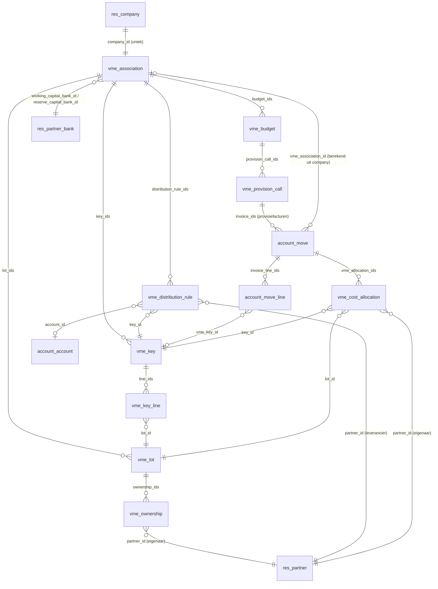

# Datamodel

## Eigen modellen

| Model | Betekenis | Belangrijke velden en regels |
| --- | --- | --- |
| `vme.association` | VME | `company_id` (verplicht via SQL-check, uniek); naam, KBO, adres zijn `related` naar de company; `working_capital_bank_id` en `reserve_capital_bank_id` (moeten verschillen); `untrusted_fund_bank_ids` (berekend: rekeningen zonder `allow_out_payment`). KBO-controle modulo 97. |
| `vme.lot` | Kavel | `name` uniek per VME, `lot_type` (appartement, garage, berging, handelsruimte, andere), `floor`, `current_owner_id` (berekend voor vandaag). `_get_owner_on(date)` geeft de eigenaar op een datum. |
| `vme.ownership` | Eigendom | `lot_id`, `partner_id`, `date_start`, `date_end` (leeg = loopt nog). Geen overlap per kavel: één eigenaar tegelijk. |
| `vme.key` | Verdeelsleutel | `key_type` (algemeen, lift, verwarming, op verbruik, andere), `total_shares` (standaard 1000), `line_ids`; `is_balanced` en `shares_difference` berekend. Opslaan faalt als de som niet het totaal is. |
| `vme.key.line` | Quotiteit | `key_id`, `lot_id` (uniek per sleutel, zelfde VME), `shares` (2 decimalen), `percentage`. |
| `vme.distribution.rule` | Verdeelregel | Per VME één regel per leverancier (`partner_id`), met `key_id` en optioneel `account_id`. `_find_rule(company, partner)` zoekt ook op de commerciële partner. |
| `vme.cost.allocation` | Kostenverdeling | Eén rij per factuurregel × kavel × eigenaarssegment: `move_id`, `move_line_id`, `key_id`, `lot_id`, `partner_id`, `shares`, `date_from`, `date_to`, `days`, `amount`. Alleen-lezen voor gebruikers; wordt bij elke verdeling vervangen. |
| `vme.budget` | Jaarbudget | Uniek per VME en jaar. `working_capital_budget`, `reserve_capital_contribution`, `calls_per_year` (1, 2, 4, 12), `reserve_exception_by_general_assembly`; berekend: `previous_year_charges`, `reserve_minimum`, `reserve_warning`. |
| `vme.sale.file` | Verkoopdossier | VME, `lot_ids`, verkoper, koper, notaris; datums en termijnen van de eerste (15 dagen) en tweede vraag (30 dagen), `deed_date`, `state`. Antwoord via `_get_notary_information()`, overdracht via `action_deed_done()`. Zie [verkoop-notaris.md](verkoop-notaris.md). |
| `vme.provision.call` | Provisieoproep | Uniek per budget en nummer. `date`, `date_due`, `invoice_ids`; opgeslagen sommen per fonds, betaalstatus berekend met `compute_sudo`. Niet verwijderbaar (geen `unlink` in de ACL). |

Wizards (transient): `vme.provision.call.wizard` en `vme.annual.statement.wizard`, elk met een HTML-voorbeeld (`preview_html`).

## Uitbreidingen op Odoo-modellen

| Model | Veld | Uitleg |
| --- | --- | --- |
| `account.move` | `vme_association_id` | Opgeslagen compute op `company_id`: de VME waarvan de company de factuur draagt. |
| `account.move` | `vme_period_start`, `vme_period_end` | Kostperiode. Standaard de factuurdatum; bij een UBL-factuur de `InvoicePeriod`. Bewerkbaar. |
| `account.move` | `vme_allocation_ids` | De kostenverdeling van deze factuur. |
| `account.move` | `vme_provision_call_id`, `vme_fund` | Op provisiefacturen: de oproep en het fonds (`working` of `reserve`). |
| `account.move.line` | `vme_key_id` | Verdeelsleutel per regel; opgeslagen compute die alleen een lege sleutel invult vanuit de verdeelregel. |

## Rekeningen

| Code | Naam | Waar |
| --- | --- | --- |
| 611000 | Onderhoudskosten en herstellingen | Standaardrekening van het aankoopdagboek van elke VME |
| 100100 | Werkkapitaal | Opbrengstzijde van provisiefacturen werkkapitaal (eigen vermogen) |
| 100200 | Reservekapitaal | Idem voor reservekapitaal |

De codes 100100 en 100200 zijn eigen keuzes en moeten nog afgestemd worden op het minimumrekeningenstelsel voor VME's (`# LEGAL-CHECK: KB 12 juli 2012`).

## Bankdagboeken

`vme.association._ensure_fund_bank_journals()` zorgt voor één bankdagboek per fonds, gekoppeld aan de bankrekening van dat fonds: **WK Werkkapitaal** (hergebruikt het standaard bankdagboek van het rekeningstelsel) en **RK Reservekapitaal**. De demohistoriek gebruikt die dagboeken voor de betalingen.
