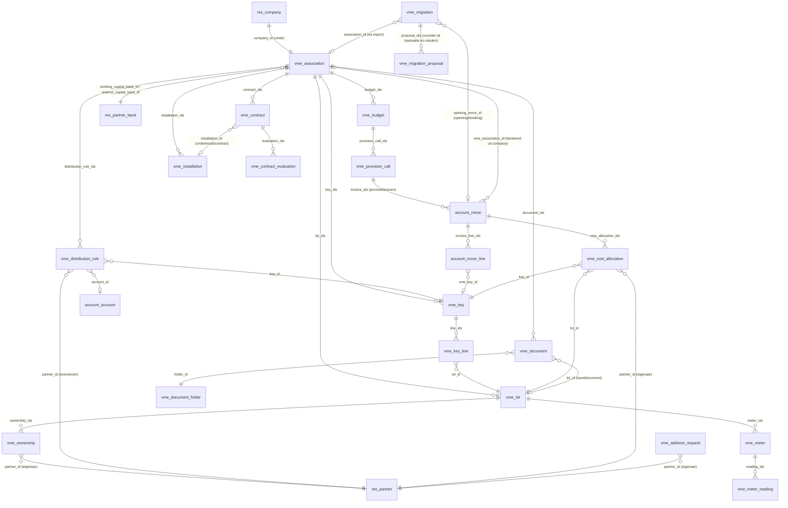

# Datamodel

## Eigen modellen

| Model | Betekenis | Belangrijke velden en regels |
| --- | --- | --- |
| `vme.association` | VME | `company_id` (verplicht via SQL-check, uniek); naam, KBO, adres zijn `related` naar de company; `working_capital_bank_id` en `reserve_capital_bank_id` (moeten verschillen); `untrusted_fund_bank_ids` (berekend: rekeningen zonder `allow_out_payment`); `manager_user_id` (dossierbeheerder, stap 29). KBO-controle modulo 97. |
| `vme.lot` | Kavel | `name` uniek per VME, `lot_type` (appartement, garage, berging, handelsruimte, andere), `floor`, `current_owner_id` (berekend voor vandaag). `_get_owner_on(date)` geeft de eigenaar op een datum. |
| `vme.ownership` | Eigendom | `lot_id`, `partner_id`, `date_start`, `date_end` (leeg = loopt nog). Geen overlap per kavel: één eigenaar tegelijk. |
| `vme.key` | Verdeelsleutel | `key_type` (algemeen, lift, verwarming, op verbruik, andere), `total_shares` (standaard 1000), `line_ids`; `is_balanced` en `shares_difference` berekend. Opslaan faalt als de som niet het totaal is. Voor "op verbruik": `meter_type` en `fixed_percent` (zie [verbruik.md](verbruik.md)). |
| `vme.meter` | Teller | `name` uniek per VME, `lot_id`, `meter_type` (water, verwarming/kostenverdeler, elektriciteit), `factor` (coëfficiënt). `_index_at(day)` en `_consumption(from, to)`. |
| `vme.meter.reading` | Meterstand | `meter_id`, `date` (stand op het einde van de dag), `value`, `source`; uniek per teller en dag, nooit dalend. |
| `vme.key.line` | Quotiteit | `key_id`, `lot_id` (uniek per sleutel, zelfde VME), `shares` (2 decimalen), `percentage`. |
| `vme.distribution.rule` | Verdeelregel | Per VME één regel per leverancier (`partner_id`), met `key_id` en optioneel `account_id`. `_find_rule(company, partner)` zoekt ook op de commerciële partner. |
| `vme.cost.allocation` | Kostenverdeling | Eén rij per factuurregel × kavel × eigenaarssegment: `move_id`, `move_line_id`, `key_id`, `lot_id`, `partner_id`, `shares`, `date_from`, `date_to`, `days`, `amount`. Alleen-lezen voor gebruikers; wordt bij elke verdeling vervangen. |
| `vme.budget` | Jaarbudget | Uniek per VME en jaar. `working_capital_budget`, `reserve_capital_contribution`, `calls_per_year` (1, 2, 4, 12), `reserve_exception_by_general_assembly`; berekend: `previous_year_charges`, `reserve_minimum`, `reserve_warning`. |
| `vme.sale.file` | Verkoopdossier | VME, `lot_ids`, verkoper, koper, notaris; datums en termijnen van de eerste (15 dagen) en tweede vraag (30 dagen), `deed_date`, `state`. Antwoord via `_get_notary_information()`, overdracht via `action_deed_done()`. Zie [verkoop-notaris.md](verkoop-notaris.md). |
| `vme.works` / `vme.works.quote` | Werkdossier en offertes | Aan een aangenomen `vme.assembly.item`; budget en sleutel uit de beslissing, `financing` (werk- of reservekapitaal), statussen van voorbereiding tot definitieve oplevering. Zie [werken-schade.md](werken-schade.md). |
| `vme.works.comparison` / `.column` / `.line` | Offertevergelijking | Aan een `vme.works`; kolommen per offerte (`quote_id`, PDF, gelezen bedragen en btw-tarief), rijen per rubriek met per kolom waarde, pagina en status; statussen Wacht op AI, Concept, Goedgekeurd; `assembly_id` voor de oproeping. Zie [offertes-vergelijken.md](offertes-vergelijken.md). |
| `vme.insurance.policy` / `vme.damage.claim` | Polis en schadedossier | Polis per VME met vrijstelling en aangiftetermijn; schadedossier met kavels, termijnen, expertise, herstelling en vergoeding. |
| `vme.provision.call` | Provisieoproep | Uniek per budget en nummer. `date`, `date_due`, `invoice_ids`; opgeslagen sommen per fonds, betaalstatus berekend met `compute_sudo`. Niet verwijderbaar (geen `unlink` in de ACL). |
| `vme.arrears` | Achterstal (SQL-view) | Open, vervallen debiteurenlijnen van alle VME's met ouderdom; zie [invordering.md](invordering.md). |
| `vme.collection` | Invorderingsdossier | Per VME en eigenaar; niveau, kosten, doorsturen. Eén niet-afgesloten dossier per VME en eigenaar. |
| `vme.collection.reminder` | Herinnering | Niveau 1-3, concept of verstuurd, momentopname van de open bedragen en de tekst. |
| `vme.mandate` | Mandaat in de raad of als commissaris | `association_id`, `role` (voorzitter, lid, commissaris), `partner_id`, `date_start`, `date_end` (standaard één jaar), `assembly_item_id`, `audit_year`, `user_id`; berekend `is_current`, `is_owner`. Leden van de raad moeten eigenaar zijn, één voorzitter tegelijk. Zie [raad-commissaris.md](raad-commissaris.md). |
| `vme.assembly.signature` | Elektronische handtekening van de notulen | AV, ondertekenaar, `role`, `document_sha256`, `state`, `signed_at`, `signed_name`, `ip_address`, `user_agent`; berekend `is_valid`. Onveranderlijk na het tekenen. Zie [digitale-av.md](digitale-av.md). |
| `vme.council.dossier` | Lopend dossier voor de raad (SQL-view) | Verkopen, invorderingen, open keuringsopmerkingen en opvolgtaken van de AV; `dossier_type`, `status`, `date_deadline`, `res_model`, `res_id`. Uitbreidbaar via `_dossier_queries()`. |
| `vme.contract` | Contract | VME, soort, leverancier, optioneel de installatie; `date_end` (einde huidige periode), `auto_renew`, `renewal_months`, `notice_period_months`; opgeslagen `notice_deadline` en `next_evaluation_date`, niet opgeslagen `notice_state`, verdeelregel en `billed_this_year`. Zie [contracten.md](contracten.md). |
| `vme.contract.evaluation` | Jaarlijkse evaluatie | Contract, datum, beoordeling, voorstel, optioneel de AV. |
| `vme.request` | Aanvraag van een bewoner | VME, kavel, `request_type_id`, `channel`, `requester_id` en `requester_role` (herkend aan het e-mailadres), `owner_id`, `state`, bewijs, bestelling, levering, checklist. Zie [aanvragen.md](aanvragen.md). |
| `vme.request.type` | Soort aanvraag | `code` (uniek, één per procedure), `needs_verification`, `checklist` (tekst). |
| `vme.request.check` | Stap van de checklist | `request_id`, `name`, `done`, `done_date`. |
| `vme.lot.contact` | Huurder of bewoner van een kavel | `lot_id`, `partner_id`, `role` (huurder, bewoner, contactpersoon), `date_start`, `date_end`. |
| `vme.lot.key` | Sleutelregister | `lot_id`, `kind`, `number`, `issue_date`, `partner_id` (in handen van), `state` (in gebruik, geblokkeerd, ingeleverd), `request_id`. |
| `vme.bill.ai.check` | Controle van een door AI gelezen factuurveld | Per factuur één rij per gelezen veld: `field_code`, `name`, `value`, `confidence` (hoog/gemiddeld/laag), `status` (in orde/nakijken/gevaar), `message`. Wordt bij elke controle vervangen. Zie [pdf-ai-lezen.md](pdf-ai-lezen.md). |
| `vme.communication` | Verzending | Mededeling of bevraging per VME: selectie (`audience`), `reference_date`, gevraagd kanaal, tekst met plaatshouders, antwoorden (`option_ids`). Concept → verstuurd. Zie [communicatie.md](communicatie.md). |
| `vme.communication.log` | Communicatielog | Eén lijn per ontvanger en verzending, ook voor oproepingen en herinneringen (`source_model`, `source_id`); echt kanaal, status, antwoord op een bevraging met `answer_channel` (portaal of ingegeven door de syndicus, stap 27). |
| `vme.registered.mail` | Aangetekende zending | Volgnummer `AT/jaar/nnnn`, bestemmeling, adres als tekst, PDF, papier of elektronisch, zendingsnummer, status tot ontvangen of niet afgehaald. |
| `vme.communication.template` | Sjabloon | Onderwerp, tekst, korte tekst, kanaal, vraag en antwoorden. |
| `vme.budget.line` | Budget per rekening en sleutel | `budget_id`, `account_id`, `key_id` (optioneel), `name`, `amount`; op `vme.budget` berekend `lines_total` en `unassigned_amount`. Zie [gebouwkaart.md](gebouwkaart.md). |
| `vme.budget.analysis` | Budgetopvolging (SQL-view) | Budgetregels, niet-ingedeeld budget en werkelijke kosten per VME, jaar, rekening en sleutel; `budget_to_date` gespreid per dag tot vandaag. |
| `vme.capital.movement` | Verloop kapitalen (SQL-view) | Provisies en gebruik van werk- en reservekapitaal per datum, voor een gecumuleerde lijngrafiek. |
| `vme.cycle.step` | Stap in de jaarcyclus | Uniek per VME, jaar, `code` en `sequence` (nummer van de provisieoproep); `date_ready`, `date_deadline`, `state` (gepland, klaargezet, afgerond, niet van toepassing), `user_id`, `res_model`/`res_id` van het concept; berekend `is_late`. Op `vme.association`: `cycle_start_date`, `cycle_user_id`, `cycle_current_step`, `cycle_late_count`. Zie [jaarcyclus.md](jaarcyclus.md). |
| `vme.migration` | Overstap uit een ander pakket | `attachment_ids` (exportbestanden), `document_ids` (basisakte en notulen), `ai_state` (geen, te lezen, gelezen), `ai_model`, `source_format`, `state` (nieuw, proefrun gedaan, geïmporteerd), `report_html`, `error_count`, `warning_count`, `transition_date`, `association_id`, `opening_move_id`. Zie [migratie.md](migratie.md). |
| `vme.migration.proposal` | Voorstelregel uit de basisakte of de notulen | `migration_id`, `sequence`, `kind` (vme, kavel, aandeel, werken, procedure, mandaat), waardevelden per soort (tekst), bron `attachment_id`/`page`/`fragment`, `confidence`, `note`, `origin` (ai, manueel), `state` (na te kijken, aanvaard, geweigerd), `edited`, berekend `uncertain`. Zie [overname-ai.md](overname-ai.md). |

`vme.work.item` (transient, stap 29): één lijn van **Mijn werk vandaag** per taak, signaal of concept, met `association_id`, `kind`, `item_type`, `date_deadline`, `urgency`, `user_id`, `res_model`/`res_id` en `activity_id`; elke opening bouwt de lijst van de gebruiker opnieuw (zie [werkbak.md](werkbak.md)).

Wizards (transient): `vme.provision.call.wizard`, `vme.annual.statement.wizard` en `vme.financial.statements.wizard` (balans en resultatenrekening, stap 26), elk met een HTML-voorbeeld (`preview_html`).
Wizards (transient): `vme.provision.call.wizard` en `vme.annual.statement.wizard`, elk met een HTML-voorbeeld (`preview_html`). Meer dan 20 VME's in de provisiewizard worden een `vme.provision.call.run` (budgetjaar, nummer, datums, VME's, verwerkte VME's, status, logboek), die een cron VME per VME afwerkt (zie [schaal.md](schaal.md)).

### Documenten en portaal (stap 15)

| Model | Betekenis | Belangrijke velden en regels |
| --- | --- | --- |
| `vme.document.folder` | Documentmap | `scope` (`vme` of `lot`), `portal_visible` als standaard voor nieuwe documenten. Vaste mappen in `data/document_folders.xml`. |
| `vme.document` | Document | `association_id`, `lot_id` (verplicht in een kavelmap, verboden in een VME-map, zelfde VME), `folder_id`, `date` (bepaalt de zichtbaarheid), `datas` (bijlage), `filename`, `portal_visible`, `certificate_type` en `valid_until` voor een verplicht attest (zie [verzekeringen-attesten.md](verzekeringen-attesten.md)). `_portal_domain_for(partner)` is de zichtbaarheidsregel, zie [portaal.md](portaal.md). |
| `vme.address.request` | Adreswijziging | `partner_id`, nieuwe `street`, `street2`, `zip`, `city`, `country_id`, `phone`, `email`, `old_address` (tekst bij de aanvraag), `state` (`to_approve`, `approved`, `refused`). Goedkeuren schrijft naar de partner. |
De modellen van de rentmeester (`vme.rent.*`, ook beheermandaten en doorstortingen) staan in de module `vme_rentmeester`; zie [rentmeester.md](rentmeester.md#datamodel). Die module breidt ook `vme.payment.batch` uit met `rent_company_id`.
| `vme.management.agreement` | Beheerovereenkomst van de syndicus met een VME | `syndic_company_id` (company met `is_syndic_office`), begin/einde, `fee_basis`, `fee_amount` per maand, `billing_period`, `indexation` (`none`/`cpi`/`percent`), `rate_ids`. Geen overlap per VME. Zie [syndicus.md](syndicus.md). |
| `vme.service.rate` | Prijs van een extra prestatie in een overeenkomst | `service_type`, `price`; uniek per overeenkomst en soort. |
| `vme.service.line` | Prestatie van de syndicus | Bron (`res_model`, `res_id`), soort, datum, `price_unit`, `state` (`to_invoice`/`invoiced`/`no_charge`, uit `invoice_line_id`), `recharge_partner_id`. Uniek per bron en soort. |
| `vme.consumer.price.index` | Consumptieprijsindex per maand | `month`, `value`; voor de indexering van het ereloon. |
| `vme.syndic.mandate` | Mandaat van de syndicus | Begin, einde (max. 3 jaar), `appointment_item_id`, `previous_mandate_id`, `renewal_assembly_year`, `renewal_state` (zoekbaar), aanplakking (`posting_deadline`, `posted_date`, `posting_document_id`). |
De modellen van de rentmeester (`vme.rent.*`) staan in de module `vme_rentmeester`; zie [rentmeester.md](rentmeester.md#datamodel).

## Uitbreidingen op Odoo-modellen

| Model | Veld | Uitleg |
| --- | --- | --- |
| `account.move` | `vme_association_id` | Opgeslagen compute op `company_id`: de VME waarvan de company de factuur draagt. |
| `account.move` | `vme_period_start`, `vme_period_end` | Kostperiode. Standaard de factuurdatum; bij een UBL-factuur de `InvoicePeriod`. Bewerkbaar. |
| `account.move` | `vme_allocation_ids` | De kostenverdeling van deze factuur. |
| `account.move` | `vme_provision_call_id`, `vme_fund` | Op provisiefacturen: de oproep en het fonds (`working` of `reserve`). |
| `account.move` | `vme_request_id` | Privé-kost van een aanvraag: de factuur aan de eigenaar, of de factuur van de slotenmaker. Niet verdeeld en niet in de jaarafrekening. |
| `account.move` | `vme_collection_id` | Op een factuur met nalatigheidsinterest en schadevergoeding: het invorderingsdossier. |
| `account.move` | `vme_ai_state`, `vme_ai_reading`, `vme_ai_model`, `vme_ai_iban`, `vme_ai_check_ids`, `vme_ai_danger_count`, `vme_ai_warning_count`, `vme_ai_reviewed_by_id`, `vme_ai_reviewed_date` | PDF-factuur zonder UBL, gelezen door AI (stap 21, zie [pdf-ai-lezen.md](pdf-ai-lezen.md)). `vme_ai_iban` is het IBAN zoals gelezen; het wordt nooit een `res.partner.bank`. |
| `vme.association` | `vme_receive_document()`, `_vme_document_folder()` | Door AI geklasseerd document als bijlage op de VME; het tweede is het uitbreidingspunt voor de mappen van stap 15. |
| `account.bank.statement.line` | `vme_bank_fund`, `vme_match_state`, `vme_exception`, `vme_days_late`, `vme_match_note`, `vme_structured_reference`, `vme_candidate_move_ids`, `vme_matched_move_ids`, `vme_follow_up` | Koppeling van bankbewegingen met provisies en leveranciersfacturen (stap 12, zie [bankafschriften.md](bankafschriften.md)). |
| `res.partner` | `vme_ownership_ids`, `vme_address_request_ids` | Eigendommen en adreswijzigingen; helpers `_vme_portal_*` voor het portaal, ook voor huurders, aanvragen en bevragingen (stap 27). |
| `vme.ownership` | `is_current`, `email`, `phone`, `contact_address`, `has_portal` | Register van eigenaars (`is_current` is zoekbaar). |
| `vme.association` / `vme.lot` | `document_ids`, `document_count` | Documenten van de VME en van de kavel. |
| `res.partner` | `vme_ownership_ids`, `vme_mandate_ids` | Omgekeerde relaties, gebruikt in de leesregel van de commissaris. |
| `res.users` | `_vme_sync_auditor_access()` | Toegestane companies van een commissaris volgen zijn lopende mandaten. |
| `account.move` | `vme_approval_state`, `vme_approved_by_id`, `vme_second_approved_by_id` (+ datums), `vme_payment_status`, `vme_payment_line_ids` | Goedkeuring vóór betaling en de laatste betaalopdracht van een leveranciersfactuur; `vme_fund` zegt op een leveranciersfactuur uit welk fonds ze betaald wordt (stap 20, zie [betalingsverkeer.md](betalingsverkeer.md)). |
| `account.bank.statement.line` | `vme_end_to_end_id`, `vme_return_reason`, `vme_payment_batch_line_ids` | SEPA-referentie en terugboekreden uit CAMT.053, en de batchbetaling die de beweging bevestigt (stap 20). |
| `res.partner` | `vme_communication_preference` | E-mail of papier voor mededelingen (stap 23). |
| `vme.lot` | `building_block` | Blok, om per blok te communiceren; `_get_tenants_on(date)` is de koppelplaats voor huurders. |
| `vme.sale.file` | `welcome_communication_id` | Concept-welkomstbrief, gemaakt bij de akte. |
| `vme.collection.reminder` | `registered_mail_id` | De aangetekende zending van een ingebrekestelling. |
| `vme.association` | `arrears_signal_threshold`, berekend: `working_capital_balance`, `reserve_capital_balance`, `arrears_amount`, `budget_usage`, `signal_*`, `signal_count`, `building_card_html` | Gebouwkaart en portefeuille (stap 22); de signalen zijn zoekbaar. |
| `res.partner` | `vme_is_supplier` (zoekbaar), `vme_supplier_contract_count`, `vme_supplier_open_amount`, `vme_supplier_card_html` | Leverancierskaart (stap 22), beperkt tot de VME's die de gebruiker mag lezen. |
| `res.company` | `is_syndic_office` | De company van het syndicuskantoor (zijn omzet). |
| `account.move` | `vme_fee_agreement_id`, `vme_fee_bill_id`, `vme_fee_invoice_id` | Ereloonfactuur van het kantoor en de conceptleveranciersfactuur die ze in de VME klaarzet. |
| `account.move.line` | `vme_service_line_id` | De prestatie die deze lijn van de ereloonfactuur aanrekent. |
| `vme.association` | `management_agreement_ids`, `syndic_mandate_ids`, `service_line_ids`, `current_agreement_id`, `current_syndic_mandate_id` | Overeenkomst en mandaat van de syndicus; `_get_syndic_mandate_on(day)` voor de jaarcyclus. |
| `account.move.line` | `vme_key_id` | Verdeelsleutel per regel; opgeslagen compute die alleen een lege sleutel invult vanuit de verdeelregel. |

## Rekeningen

| Code | Naam | Waar |
| --- | --- | --- |
| 611000 | Onderhoudskosten en herstellingen | Standaardrekening van het aankoopdagboek van elke VME |
| 100100 | Werkkapitaal | Opbrengstzijde van provisiefacturen werkkapitaal (eigen vermogen) |
| 100200 | Reservekapitaal | Idem voor reservekapitaal |
| 416100 | Door te rekenen privékosten | Privé-aanrekening van een aanvraag (factuur aan de eigenaar, credit) en de factuur van de slotenmaker (debet); wordt de eerste keer aangemaakt. Zie [aanvragen.md](aanvragen.md). |

De codes 100100 en 100200 zijn eigen keuzes: het minimumrekeningstelsel voor VME's (KB 12 juli 2012) heeft geen klasse 10. De balans en resultatenrekening van stap 26 tonen ze als voorschotten 700/701 en over te dragen middelen 489; zie [financiele-rapporten.md](financiele-rapporten.md). Btw op leveranciersfacturen staat sinds stap 26 op de kostenrekening, niet op 411000.

## Bankdagboeken

`vme.association._ensure_fund_bank_journals()` zorgt voor één bankdagboek per fonds, gekoppeld aan de bankrekening van dat fonds: **WK Werkkapitaal** (hergebruikt het standaard bankdagboek van het rekeningstelsel) en **RK Reservekapitaal**. De demohistoriek gebruikt die dagboeken voor de betalingen. Het inlezen van bankafschriften (stap 12) zoekt het dagboek op het rekeningnummer in het bestand en maakt de dagboeken aan als ze nog niet bestaan.

## Betalingsverkeer (stap 20)

| Model | Belangrijkste velden | Uitleg |
| --- | --- | --- |
| `vme.association` | `payment_approval_threshold`, `payment_second_approver_id`, `sepa_creditor_identifier`, `sepa_mandate_ids` | Bedrag vanaf wanneer een tweede goedkeuring nodig is, wie ze geeft, en de schuldeiseridentificatie (standaard uit het KBO-nummer). |
| `vme.sepa.mandate` | `association_id`, `partner_id`, `partner_bank_id`, `reference`, `signature_date`, `state`, `first_collection_done` | SEPA-mandaat van een eigenaar bij een VME; één actief mandaat per eigenaar en VME. |
| `vme.payment.batch` | `batch_type`, `association_id`, `fund`, `provision_call_id`, `due_until`, `execution_date`, `state`, `file_data`, `message_ref` | Een SEPA-bestand: overschrijvingen per fondsrekening of domiciliëringen per provisieoproep. |
| `vme.payment.batch.line` | `move_id`, `partner_id`, `partner_bank_id`, `mandate_id`, `amount`, `communication`, `end_to_end_id`, `state`, `statement_line_id`, `return_statement_line_id`, `return_reason` | Eén betaling of inning; status Concept, Verstuurd, Bevestigd door de bank of Teruggekomen. |
