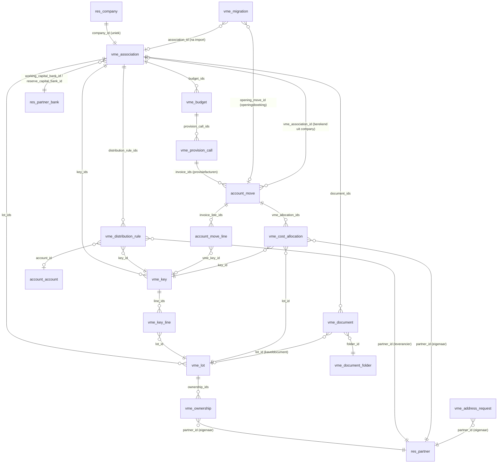

# Datamodel

## Eigen modellen

| Model | Betekenis | Belangrijke velden en regels |
| --- | --- | --- |
| `vme.association` | VME | `company_id` (verplicht via SQL-check, uniek); naam, KBO, adres zijn `related` naar de company; `working_capital_bank_id` en `reserve_capital_bank_id` (moeten verschillen); `untrusted_fund_bank_ids` (berekend: rekeningen zonder `allow_out_payment`). KBO-controle modulo 97. |
| `vme.lot` | Kavel | `name` uniek per VME, `lot_type` (appartement, garage, berging, handelsruimte, andere), `floor`, `current_owner_id` (berekend voor vandaag). `_get_owner_on(date)` geeft de eigenaar op een datum. |
| `vme.ownership` | Eigendom | `lot_id`, `partner_id`, `date_start`, `date_end` (leeg = loopt nog). Geen overlap per kavel: één eigenaar tegelijk. |
| `vme.key` | Verdeelsleutel | `key_type` (algemeen, lift, verwarming, op verbruik, andere), `total_shares` (standaard 1000), `line_ids`; `is_balanced` en `shares_difference` berekend. Opslaan faalt als de som niet het totaal is. |
| `vme.key.line` | Quotiteit | `key_id`, `lot_id` (uniek per sleutel, zelfde VME), `shares` (2 decimalen), `percentage`. |
| `vme.distribution.rule` | Verdeelregel | Per VME één regel per leverancier (`partner_id`), met `key_id` en optioneel `account_id`. `_find_rule(company, partner)` zoekt ook op de commerciële partner. |
| `vme.cost.allocation` | Kostenverdeling | Eén rij per factuurregel × kavel × eigenaarssegment: `move_id`, `move_line_id`, `key_id`, `lot_id`, `partner_id`, `shares`, `date_from`, `date_to`, `days`, `amount`. Alleen-lezen voor gebruikers; wordt bij elke verdeling vervangen. |
| `vme.budget` | Jaarbudget | Uniek per VME en jaar. `working_capital_budget`, `reserve_capital_contribution`, `calls_per_year` (1, 2, 4, 12), `reserve_exception_by_general_assembly`; berekend: `previous_year_charges`, `reserve_minimum`, `reserve_warning`. |
| `vme.sale.file` | Verkoopdossier | VME, `lot_ids`, verkoper, koper, notaris; datums en termijnen van de eerste (15 dagen) en tweede vraag (30 dagen), `deed_date`, `state`. Antwoord via `_get_notary_information()`, overdracht via `action_deed_done()`. Zie [verkoop-notaris.md](verkoop-notaris.md). |
| `vme.works` / `vme.works.quote` | Werkdossier en offertes | Aan een aangenomen `vme.assembly.item`; budget en sleutel uit de beslissing, `financing` (werk- of reservekapitaal), statussen van voorbereiding tot definitieve oplevering. Zie [werken-schade.md](werken-schade.md). |
| `vme.insurance.policy` / `vme.damage.claim` | Polis en schadedossier | Polis per VME met vrijstelling en aangiftetermijn; schadedossier met kavels, termijnen, expertise, herstelling en vergoeding. |
| `vme.provision.call` | Provisieoproep | Uniek per budget en nummer. `date`, `date_due`, `invoice_ids`; opgeslagen sommen per fonds, betaalstatus berekend met `compute_sudo`. Niet verwijderbaar (geen `unlink` in de ACL). |
| `vme.arrears` | Achterstal (SQL-view) | Open, vervallen debiteurenlijnen van alle VME's met ouderdom; zie [invordering.md](invordering.md). |
| `vme.collection` | Invorderingsdossier | Per VME en eigenaar; niveau, kosten, doorsturen. Eén niet-afgesloten dossier per VME en eigenaar. |
| `vme.collection.reminder` | Herinnering | Niveau 1-3, concept of verstuurd, momentopname van de open bedragen en de tekst. |
| `vme.migration` | Overstap uit een ander pakket | `attachment_ids` (exportbestanden), `source_format`, `state` (nieuw, proefrun gedaan, geïmporteerd), `report_html`, `error_count`, `warning_count`, `transition_date`, `association_id`, `opening_move_id`. Zie [migratie.md](migratie.md). |

Wizards (transient): `vme.provision.call.wizard` en `vme.annual.statement.wizard`, elk met een HTML-voorbeeld (`preview_html`).

### Documenten en portaal (stap 15)

| Model | Betekenis | Belangrijke velden en regels |
| --- | --- | --- |
| `vme.document.folder` | Documentmap | `scope` (`vme` of `lot`), `portal_visible` als standaard voor nieuwe documenten. Vaste mappen in `data/document_folders.xml`. |
| `vme.document` | Document | `association_id`, `lot_id` (verplicht in een kavelmap, verboden in een VME-map, zelfde VME), `folder_id`, `date` (bepaalt de zichtbaarheid), `datas` (bijlage), `filename`, `portal_visible`. `_portal_domain_for(partner)` is de zichtbaarheidsregel, zie [portaal.md](portaal.md). |
| `vme.address.request` | Adreswijziging | `partner_id`, nieuwe `street`, `street2`, `zip`, `city`, `country_id`, `phone`, `email`, `old_address` (tekst bij de aanvraag), `state` (`to_approve`, `approved`, `refused`). Goedkeuren schrijft naar de partner. |

## Uitbreidingen op Odoo-modellen

| Model | Veld | Uitleg |
| --- | --- | --- |
| `account.move` | `vme_association_id` | Opgeslagen compute op `company_id`: de VME waarvan de company de factuur draagt. |
| `account.move` | `vme_period_start`, `vme_period_end` | Kostperiode. Standaard de factuurdatum; bij een UBL-factuur de `InvoicePeriod`. Bewerkbaar. |
| `account.move` | `vme_allocation_ids` | De kostenverdeling van deze factuur. |
| `account.move` | `vme_provision_call_id`, `vme_fund` | Op provisiefacturen: de oproep en het fonds (`working` of `reserve`). |
| `account.move` | `vme_collection_id` | Op een factuur met nalatigheidsinterest en schadevergoeding: het invorderingsdossier. |
| `account.bank.statement.line` | `vme_bank_fund`, `vme_match_state`, `vme_exception`, `vme_days_late`, `vme_match_note`, `vme_structured_reference`, `vme_candidate_move_ids`, `vme_matched_move_ids`, `vme_follow_up` | Koppeling van bankbewegingen met provisies en leveranciersfacturen (stap 12, zie [bankafschriften.md](bankafschriften.md)). |
| `res.partner` | `vme_ownership_ids`, `vme_address_request_ids` | Eigendommen en adreswijzigingen; helpers `_vme_portal_*` voor het portaal. |
| `vme.ownership` | `is_current`, `email`, `phone`, `contact_address`, `has_portal` | Register van eigenaars (`is_current` is zoekbaar). |
| `vme.association` / `vme.lot` | `document_ids`, `document_count` | Documenten van de VME en van de kavel. |
| `account.move.line` | `vme_key_id` | Verdeelsleutel per regel; opgeslagen compute die alleen een lege sleutel invult vanuit de verdeelregel. |

## Rekeningen

| Code | Naam | Waar |
| --- | --- | --- |
| 611000 | Onderhoudskosten en herstellingen | Standaardrekening van het aankoopdagboek van elke VME |
| 100100 | Werkkapitaal | Opbrengstzijde van provisiefacturen werkkapitaal (eigen vermogen) |
| 100200 | Reservekapitaal | Idem voor reservekapitaal |

De codes 100100 en 100200 zijn eigen keuzes en moeten nog afgestemd worden op het minimumrekeningenstelsel voor VME's (`# LEGAL-CHECK: KB 12 juli 2012`).

## Bankdagboeken

`vme.association._ensure_fund_bank_journals()` zorgt voor één bankdagboek per fonds, gekoppeld aan de bankrekening van dat fonds: **WK Werkkapitaal** (hergebruikt het standaard bankdagboek van het rekeningstelsel) en **RK Reservekapitaal**. De demohistoriek gebruikt die dagboeken voor de betalingen. Het inlezen van bankafschriften (stap 12) zoekt het dagboek op het rekeningnummer in het bestand en maakt de dagboeken aan als ze nog niet bestaan.
