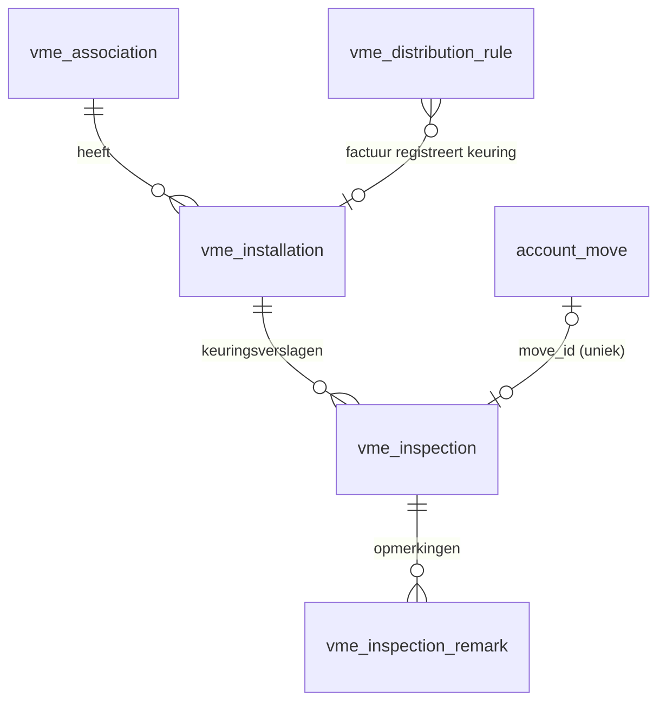

# Keuringen en lift-opvolging (stap 6b)

## Modellen (`addons/vme_belgie/models/vme_installation.py`)

- **`vme.installation`** (`mail.thread`, `mail.activity.mixin`): soort, firma's, frequentie (`inspection_interval_months`, standaard uit `DEFAULT_INTERVAL_MONTHS`, aanpasbaar).
  - Het onderhoudscontract is sinds stap 18 een `vme.contract` met `installation_id`; de installatie toont het via `maintenance_contract_id` en `maintenance_contract_end` (zie [contracten.md](contracten.md)).
  - Opgeslagen berekende datums:
    - `last_inspection_date` = max datum van verslagen met soort in `PERIODIC_KINDS` (inspectie en herkeuring; een onderhoudsbezoek telt niet)
    - `next_inspection_date` = laatste + frequentie
    - voor liften ook `last/next_risk_analysis_date` (+15 jaar)
    - `retest_required`: het laatste periodieke verslag is "niet conform"
  - Niet opgeslagen: `due_state` en `risk_analysis_due_state` hangen af van vandaag. Zoekfilters gebruiken daarom domeinen op de opgeslagen datums met `context_today()`.
- **`vme.inspection`**: verslag (`report` als bijlage), soort, resultaat, `move_id` met unieke constraint.
- **`vme.inspection.remark`**: ernst, termijn, verantwoordelijke en status.
  - `is_open` is opgeslagen; `is_overdue` heeft een `_search_is_overdue` (open en termijn < vandaag).
  - `write()` vult `resolved_date` in bij "opgelost" of "herkeurd".

Alle wettelijke standaarden staan bovenaan het bestand, elk met `# LEGAL-CHECK:`.

## Taken (cron)

`ir_cron_vme_inspection_activities` draait dagelijks `vme.installation._cron_schedule_inspection_activities()`:
- Voor elke installatie waarvan de volgende keuring of risicoanalyse binnen `ACTIVITY_LEAD_DAYS` (60) valt, komt er één to-do (`mail.mail_activity_data_todo`) voor `responsible_user_id`.
- Dubbels worden vermeden met `activity_inspection_due_date` en `activity_risk_analysis_due_date`: er komt pas een nieuwe taak als de vervaldatum verandert.
- De demolader roept de cron één keer aan, zodat de demo meteen taken toont.

## Factuurkoppeling

- `vme.distribution.rule.installation_id` is optioneel.
- `account.move._post()` roept na `_vme_auto_distribute()` ook `_vme_register_inspections()` aan.
- Bij een leveranciersfactuur zoekt die de regel (`_find_rule`) en vergelijkt het `commercial_partner_id` van de leverancier met dat van `inspection_partner_id` van de installatie.
- Klopt dat, dan maakt `_register_inspection_from_bill()` een verslag op de factuurdatum, met resultaat "conform" en een bericht in beide chatters.
- Dezelfde factuur wordt nooit twee keer verwerkt: er is een search op `move_id` en een unieke constraint.

## Tests

`tests/test_installations.py` draait met `freezegun` op 5 november 2026, zodat de vervalstatussen stabiel blijven. Getest worden:
- de frequenties en grenzen
- dat een onderhoudsbezoek niet als keuring telt, en de risicoanalyse
- de herkeuring
- dat de cron per vervaldatum één taak maakt
- de opmerkingen en "over termijn"
- de factuurkoppeling: een factuur van het keuringsorganisme, van een andere leverancier, en dezelfde factuur twee keer

## Elektrische keuring als attest

De installatie van soort `electrical` is ook het verplichte attest "Elektrische keuring gemene delen" in de opvolging van attesten (`vme_compliance.py`, zie [verzekeringen-attesten.md](verzekeringen-attesten.md)): geldig tot `next_inspection_date`, ontbrekend zonder installatie of verslag.

## Valkuilen

- **Statussen die van vandaag afhangen** (`due_state`, `is_overdue`) kun je niet opslaan; filter op de opgeslagen datum.
- **De frequentie** is een opgeslagen berekend veld dat alleen ingevuld wordt als het leeg is. Een andere soort kiezen overschrijft een eerder ingevulde frequentie dus niet.
- **Demodatums** liggen vast rond 5 november 2026. Wordt de demo veel later opgebouwd, dan staan meer keuringen in het rood.
