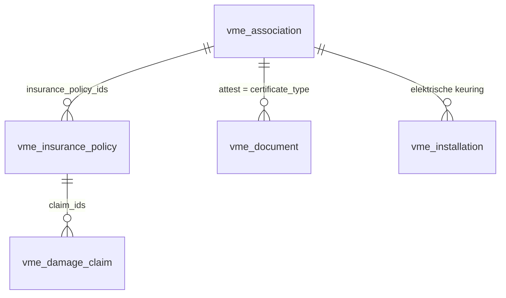

# Brandverzekering en verplichte attesten

Opvolging per gebouw van de brandverzekering (vervaldag, opzegtermijn, verzekerde waarde, schadegevallen) en van de verplichte attesten (asbest, postinterventiedossier, EPC gemene delen, elektrische keuring). Gebruikersuitleg: [kb/verzekeringen-en-attesten.md](../kb/verzekeringen-en-attesten.md).

## Geen nieuwe modellen

- **Polis** = het bestaande `vme.insurance.policy` (`models/vme_damage.py`), nu met `mail.thread`/`mail.activity.mixin`.
  - `date_end` heet in de interface **Vervaldag** (einde van de lopende periode). Geen apart veld: een stilzwijgend verlengde polis heeft maar één vervaldag.
  - `notice_deadline` = vervaldag − `NOTICE_MONTHS` (3), opgeslagen; `due_state` hergebruikt `_due_state()` en `DUE_STATES` uit `vme_installation.py` (niet opgeslagen, hangt af van vandaag).
  - `insured_value`, `valuation_basis`, `premium`, `tacit_renewal`, `user_id`, `claim_count`.
  - `action_renewed()` schuift begin en vervaldag een jaar op, vinkt de taak af en zet een bericht. Niets naar de verzekeraar.
- **Attest op papier** = `vme.document` met `certificate_type` (`asbestos`, `pid`, `epc_common`) en `valid_until` (berekend uit `date` + `CERTIFICATE_VALIDITY_MONTHS`, opgeslagen en aanpasbaar; leeg = onbeperkt). Mappen: nieuwe `folder_certificates` en de bestaande `folder_pid` (`CERTIFICATE_FOLDERS`). Zichtbaarheid in het portaal volgt de map, zoals elk document.
- **Elektrische keuring** = de bestaande `vme.installation` van soort `electrical`: het "attest" is geldig tot `next_inspection_date` en ontbreekt als er geen installatie of geen verslag is.
- `vme.association` krijgt `construction_year` en `region` (berekend uit de postcode met `region_from_zip()`, opgeslagen, aanpasbaar).

Alles staat in `models/vme_compliance.py`, behalve de polisvelden (in `vme_damage.py`, bij het model zelf).

## Regels

Bovenaan `vme_compliance.py`, elk met `# LEGAL-CHECK:` (zie [legal-checks.md](legal-checks.md)):

| Attest | Verplicht als (`certificate_applies`) | Geldig |
| --- | --- | --- |
| `asbestos` | Vlaanderen en bouwjaar < 2001 (`ASBESTOS_BUILT_BEFORE`) | 120 maanden |
| `pid` | bouwjaar ≥ 2001 (`PID_BUILT_FROM`), elk gewest | onbeperkt |
| `epc_common` | Vlaanderen en ≥ `EPC_MIN_APARTMENTS` appartementen | 120 maanden |
| `electrical` | altijd; interval in `vme_installation.py` | volgende keuring |

Zonder bouwjaar geeft `certificate_applies` `None`: de status is dan `unknown` ("Bouwjaar ontbreekt"), zonder signaal. Brussel en Wallonië zijn voor asbest en EPC nog niet opgenomen.

`_get_certificate_status(today, documents=None)` geeft per toepasselijk attest een dict: `type`, `label`, `state` (`ok`, `expiring` binnen `CERTIFICATE_LEAD_DAYS` = 90, `expired`, `missing`, `unknown`), `state_label`, `document`, `installation`, `valid_until`, `message`. Telt het meest recente document per soort (datum, dan id).

## Signalen op de gebouwkaart

Twee codes in `SIGNALS` (`vme_building_card.py`), met velden `signal_insurance` en `signal_certificate` en hun `_search_signal_*`:
- **`insurance`** (`_get_insurance_signal`): geen actieve polis van soort `building`, of alle actieve gebouwpolissen vervallen binnen `INSURANCE_SIGNAL_DAYS` (30) of zijn vervallen.
- **`certificate`** (`_get_certificate_signal`): een attest ontbreekt, of een document-attest is vervallen. Een vervallen elektrische keuring is al het signaal `inspection`; hier telt ze alleen als ze helemaal ontbreekt.

`_get_portfolio_figures()` leest de polissen en de attestdocumenten van alle VME's in twee queries en geeft ze aan `_build_signals(..., policies=, documents=)`; zo blijft de portefeuille van 200 VME's op een vast aantal queries ([schaal.md](schaal.md)). `test_certificate_signal_and_search` controleert dat batch en enkel hetzelfde geven.

Het blok "Verzekering en attesten" (`vme_belgie.compliance_content` in `views/vme_compliance_views.xml`) staat op de gebouwkaart en, via `compliance_html`, op het tabblad van de VME. De knoppen `action_add_certificate` (context `certificate_type`) openen een documentformulier met map en soort ingevuld.

## Taken (crons)

- `ir_cron_vme_policy_activities` → `vme.insurance.policy._cron_schedule_policy_activities()`: polissen met vervaldag binnen `RENEWAL_LEAD_DAYS` (120) krijgen één taak per vervaldag (`activity_due_date`, zoals bij keuringen). Deadline = opzegdatum, of de vervaldag als die al voorbij is.
- `ir_cron_vme_certificate_activities` → `vme.association._cron_schedule_certificate_activities()`: één open taak op de VME per attest dat ontbreekt, vervallen is of binnenkort vervalt. Dubbels worden vermeden op het begin van de samenvatting (het label van het attest); een nieuw geldig attest (`create`/`write` van `vme.document`) vinkt die taak af. De elektrische keuring heeft haar taak al bij de installatie.
- De demolader roept beide één keer aan.

## Notaris

`vme.sale.file._get_notary_information()` geeft `certificates` (de status, in de taal van de notaris via `with_context(lang=...)`) en `insurance` (de gebouwpolissen). Het rapport `notary_information_body` toont ze als delen 9 en 10; een ontbrekend of vervallen attest staat vet.

## Demo

| VME | Bouwjaar | Polis vervalt | Attesten |
| --- | --- | --- | --- |
| Residentie Linde | 1995 | 31-03-2027 | asbest 2024, EPC 2022, elektrische keuring 2022 |
| Hof ter Beuken | 1978 | 30-06-2027 | EPC 2023, elektrische keuring 2023, **geen asbestattest** |
| Kaaihuis | 2012 | **01-12-2026** | PID 2012, EPC 2021, elektrische keuring 2024 |

Polissen en attesten: `demo_data/vme_demo_works.py` (`POLICIES`, `CERTIFICATES`); bouwjaren en elektrische installaties: `vme_demo_data.py`. De schaalgenerator geeft elke VME een bouwjaar, een gebouwpolis, een elektrische keuring en attesten, met een eigen seed zodat de rest van de portefeuille niet verandert; ongeveer 10% van de oude gebouwen mist het asbestattest.

## Tests

`tests/test_compliance.py` (freezegun 5 november 2026): gewest uit postcode, toepasselijkheid, statussen en geldigheid, elektrische keuring via de installatie, signalen (ook zoeken en batch), polis (opzegtermijn, taak, Verlengd, schadegevallen), taken voor attesten zonder dubbels, HTML en notaris. `test_demo_data.test_demo_portfolio_signals` controleert de demo.

## Valkuilen

- Testdatabases zonder `nl_BE` tonen datums als `12/01/2026`: vergelijk in tests met `format_date()`.
- `region` hangt af van `zip`, een related veld op de company; een handmatig gekozen gewest blijft staan als de postcode onbekend is.
- De premie in de demohistoriek (facturen op het kalenderjaar) en de polisperiode lopen niet gelijk; dat is bewust zo gelaten om het demojaar en `vme_slow` niet te veranderen.
