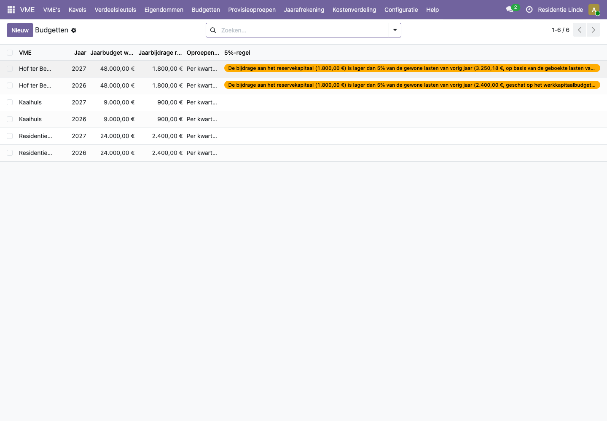
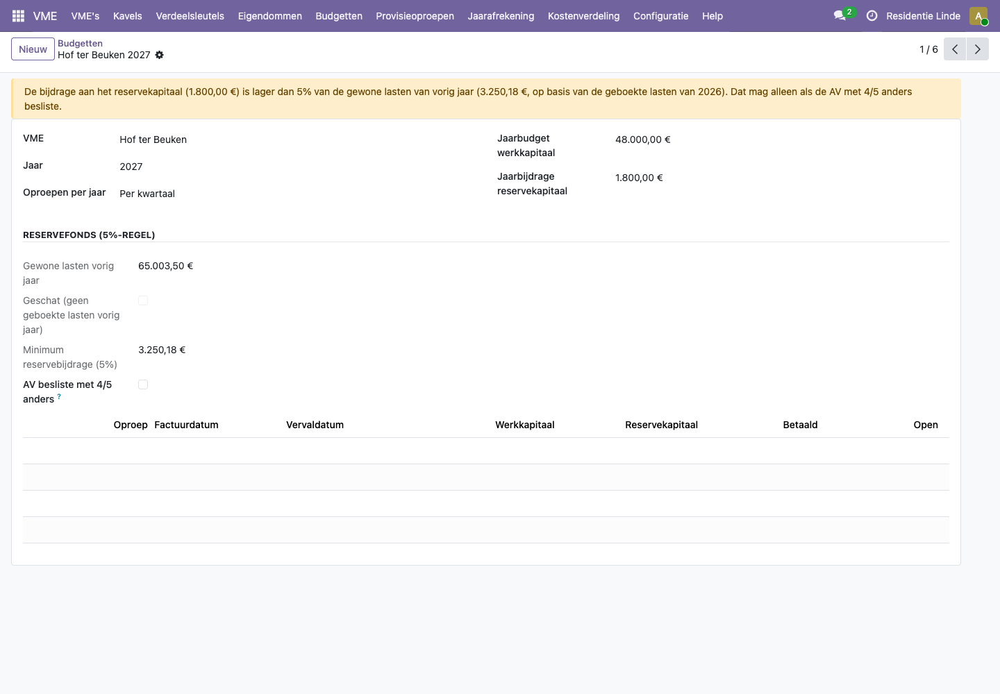
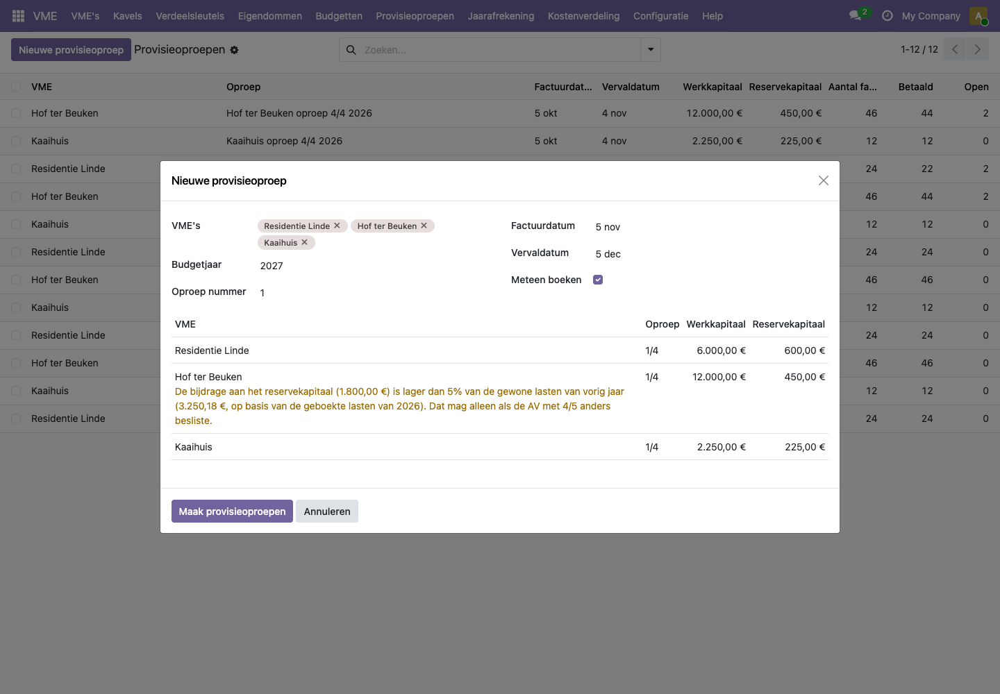
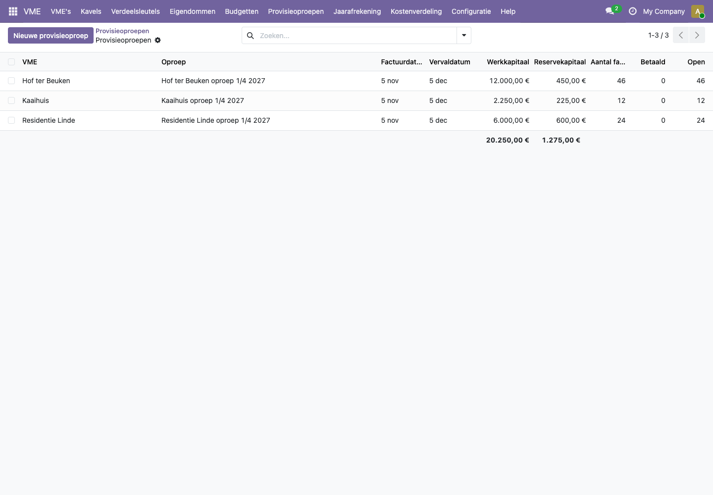
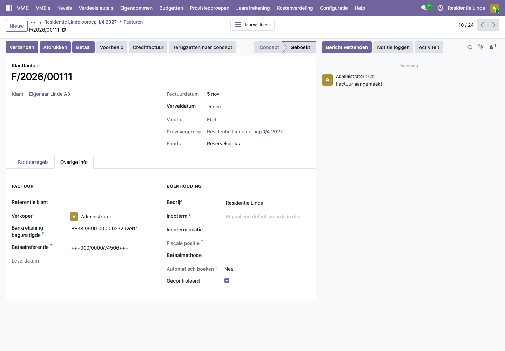
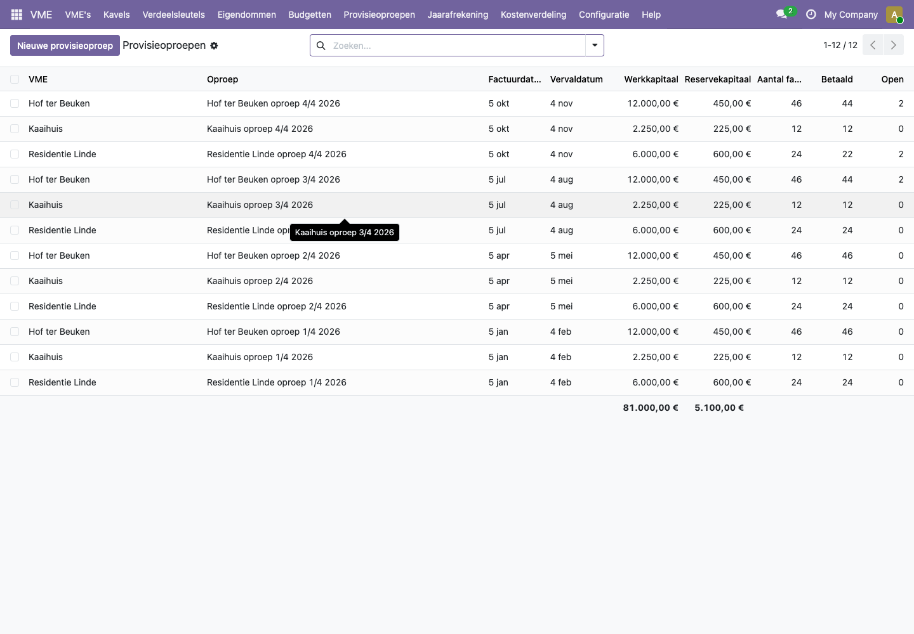

# Hoe maak ik een budget en provisieoproepen, en wat is de 5%-regel?

Een VME vraagt haar eigenaars op voorhand geld: **provisies**. Het **werkkapitaal** dekt de gewone kosten van het jaar en wordt op het einde van het jaar afgerekend. Het **reservekapitaal** spaart voor grote werken en wordt nooit terugbetaald, ook niet bij een verkoop.

Je legt per VME en per jaar een budget vast. Een provisieoproep maakt dan voor elke eigenaar twee facturen: één voor het werkkapitaal en één voor het reservekapitaal, elk met de eigen bankrekening van dat fonds en een eigen gestructureerde mededeling.

## Stappen

### 1. Het jaarbudget ingeven

1. Open **VME > Budgetten** en klik op **Nieuw**, of open de VME en ga naar het tabblad **Budgetten**.
2. Kies de **VME** en het **Jaar**.
3. Vul het **Jaarbudget werkkapitaal** en de **Jaarbijdrage reservekapitaal** in.
4. Kies hoe vaak je oproept: één keer per jaar, halfjaarlijks, per kwartaal of maandelijks.
5. Sla op.

### 2. De 5%-regel nakijken

De wet vraagt dat een VME elk jaar minstens 5% van de gewone gemeenschappelijke lasten van het vorige jaar in het reservefonds stort, tenzij de algemene vergadering met een 4/5-meerderheid anders beslist.

Het platform rekent dat minimum uit op basis van de geboekte leveranciersfacturen van het vorige jaar. Zijn er nog geen geboekte facturen (een nieuwe VME), dan gebruikt het het werkkapitaalbudget als schatting. Ligt de jaarbijdrage lager, dan verschijnt een gele waarschuwing op het budget, in de lijst en in de provisieoproep.

Besliste de algemene vergadering met 4/5 om minder op te bouwen, vink dan **AV besliste met 4/5 anders** aan. De waarschuwing verdwijnt. Oproepen blijft in elk geval mogelijk: de regel waarschuwt, maar blokkeert niet.

### 3. Een provisieoproep maken

1. Open **VME > Provisieoproepen** en klik op **Nieuwe provisieoproep**.
2. Kies bij **VME's** een of meer VME's. Je kunt alle VME's met hetzelfde ritme in één keer oproepen.
3. Vul het **Budgetjaar** en het **Oproep nummer** in (bijvoorbeeld 1 voor de eerste van vier).
4. Kijk de **Factuurdatum** en **Vervaldatum** na. Laat **Meteen boeken** aan om de facturen meteen definitief te maken.
5. Kijk het voorbeeld onderaan na: per VME de bedragen voor werk- en reservekapitaal, en eventueel de waarschuwing van de 5%-regel.
6. Klik op **Maak provisieoproepen**.

Je komt terug in de lijst met de nieuwe oproepen, per VME met het aantal facturen, hoeveel al betaald zijn en hoeveel nog open staan.

Kies je **meer dan 20 VME's**, dan maakt het platform de oproepen op de achtergrond, één VME na de andere (twee à drie seconden per VME, dus ongeveer tien minuten voor 200 VME's). Je ziet meteen een overzicht met de voortgang ("120 van 200 VME's") en kunt intussen verder werken. Als alles klaar is, krijg je een melding; de knop **Provisieoproepen tonen** opent dan de lijst. Een VME die niet kon (geen budget, een niet bevestigde rekening, geen algemene sleutel) staat met de reden in het vak **Overgeslagen of mislukt**; de andere VME's lopen gewoon door. Herstel het probleem en roep die VME apart op. Een beheerder vindt alle achtergrondtaken terug onder **VME > Configuratie > Provisieoproepen op de achtergrond**.

### 4. De facturen bekijken

Open een oproep en klik op **Facturen**. Elke eigenaar heeft een factuur voor het werkkapitaal en een voor het reservekapitaal. Een eigenaar met meerdere kavels krijgt één factuur per fonds met een regel per kavel. In het tabblad **Overige info** zie je de bankrekening van het fonds en de gestructureerde mededeling.

## Voorbeeld uit de demo

**Residentie Linde** heeft een budget van 24.000 euro werkkapitaal en 2.400 euro reservekapitaal per jaar, per kwartaal opgevraagd: 6.000 en 600 euro per oproep. Appartement A3 heeft 66/1000 in de algemene sleutel en garage G3 6/1000. "Eigenaar Linde A3" krijgt voor het reservekapitaal dus 39,60 + 3,60 = 43,20 euro, te betalen op rekening BE38 9990 0000 0272 met een eigen gestructureerde mededeling.

**Hof ter Beuken** bouwt bewust te weinig reserve op (1.800 euro per jaar). Voor 2027 rekent het platform het minimum uit op de geboekte lasten van 2026 (94.253,50 euro): 4.712,68 euro. Het budget toont daarom de waarschuwing.

In de demohistoriek 2026 betaalden bijna alle eigenaars hun vier oproepen. Uitzonderingen: "Eigenaar Linde A3" betaalde oproep 4 niet, "Eigenaar Beuken B7" oproepen 3 en 4 niet.

## Veelgestelde vragen

**Wie krijgt de oproep als een kavel net verkocht is?**
Wie eigenaar is op de factuurdatum van de oproep. De verdeling tussen verkoper en koper van de werkelijke kosten volgt later, in de jaarafrekening.

**Ik krijg "De rekening(en) ... zijn nog niet bevestigd".**
Bevestig eerst de bankrekeningen van de VME (zie [VME aanmaken](vme-aanmaken.md)). Zonder bevestiging zou Odoo de rekening weglaten van de facturen.

**Ik krijg "Oproep ... is voor ... al gemaakt".**
Elke oproep (bijvoorbeeld 2 van 4 in 2027) bestaat maar één keer per VME. Kies het volgende nummer.

**Een VME werd overgeslagen.**
Er is geen budget voor dat jaar. Odoo meldt welke VME's overgeslagen zijn; maak het budget en roep die VME apart op.

**Ik maak de eerste oproep voor volgend jaar al in december. Waar telt die mee?**
De jaarafrekening telt provisies op hun factuurdatum. Een oproep voor 2027 met factuurdatum in december 2026 telt mee in de afrekening van 2026. Geef de oproep daarom een factuurdatum in het jaar waarvoor ze dient, bijvoorbeeld 2 januari.

**Kan ik een provisieoproep verwijderen?**
Nee, alleen de facturen ervan annuleren. Zo blijft er een spoor van elke oproep.

**Wordt er btw aangerekend?**
Nee. Provisies zijn geen verkoop, dus de facturen hebben geen btw.

## Het budget per rekening en sleutel verdelen

Op het budget kunt u het werkkapitaal verdelen over rekeningen en verdeelsleutels (bv. 611000 Onderhoud lift, Liftsleutel, 3.600 €). Odoo vergelijkt die bedragen dan doorheen het jaar met de werkelijke kosten. Hoe dat werkt, leest u in [De gebouwkaart, de budgetopvolging en de portefeuille](gebouwkaart.md).
