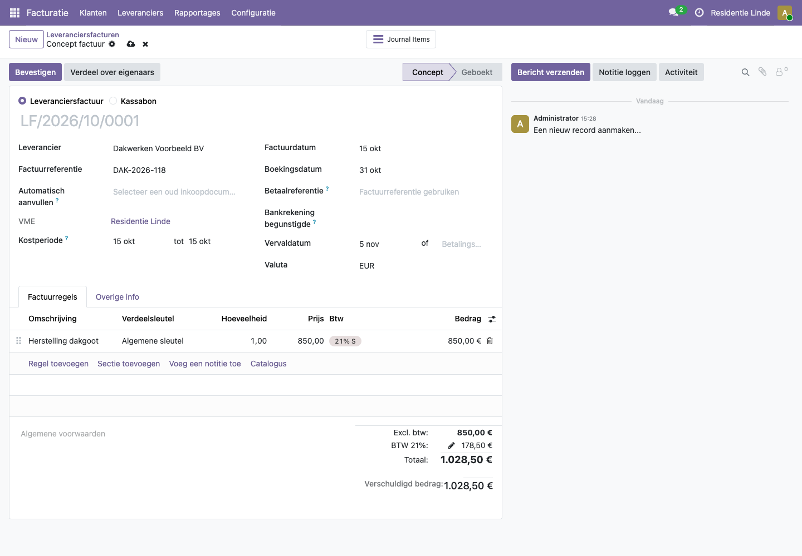
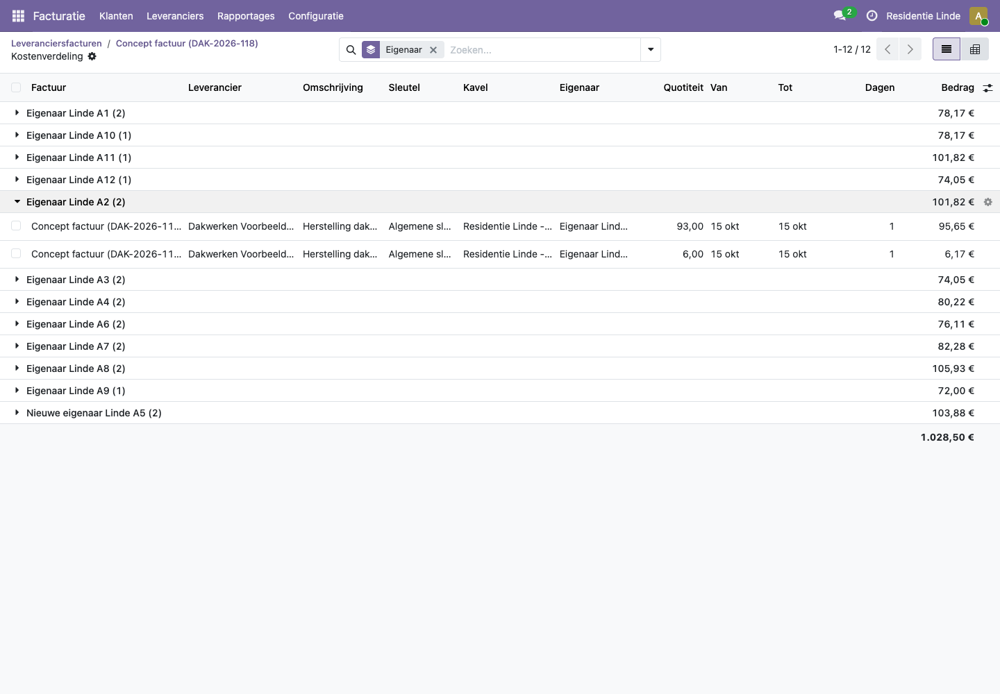
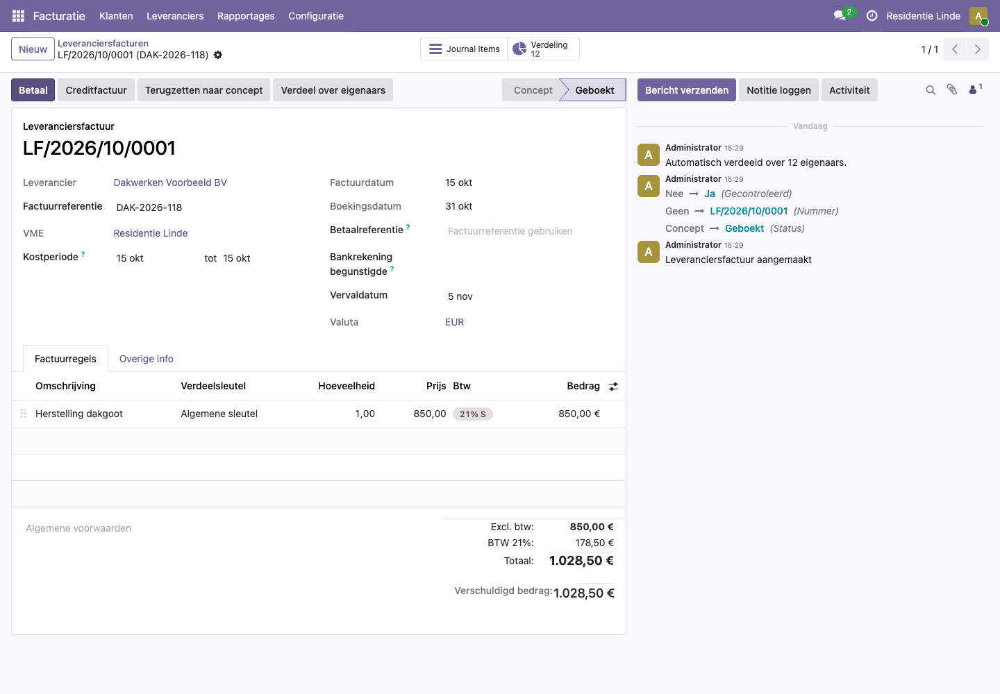

# Hoe verdeel ik een leveranciersfactuur over de eigenaars?

Elke leveranciersfactuur van een VME wordt over de eigenaars verdeeld: eerst over de kavels volgens de verdeelsleutel, daarna per kavel over de eigenaars volgens het aantal dagen dat ze eigenaar waren in de **kostperiode**. Heeft de leverancier een verdeelregel, dan gebeurt dat vanzelf (zie [Verdeelregels en Peppol-facturen](verdeelregels-en-peppol.md)). Dit artikel toont hoe je een factuur zelf verdeelt.

## Stappen

### 1. De factuur ingeven in de juiste VME

1. Kies rechtsboven in Odoo de VME waarvoor de factuur is (het bedrijf). Werk je in meerdere VME's tegelijk, zet dan alleen deze VME aan.
2. Open de app **Facturatie** en ga naar **Leveranciers > Facturen**.
3. Klik op **Nieuw**.
4. Kies de **Leverancier**, vul de **Factuurdatum** en de **Factuurreferentie** in.

Het veld **VME** vult zich vanzelf in: het platform weet uit het bedrijf over welke VME het gaat.

### 2. De kostperiode nakijken

De **Kostperiode** is de periode waarop de kost slaat. Standaard is dat de factuurdatum (één dag). Gaat de factuur over een langere periode, zoals een jaarafrekening energie of een verzekeringspremie, vul dan het begin en het einde van die periode in. Dat is belangrijk bij een verkoop: alleen dan worden de kosten correct tussen verkoper en koper verdeeld.

### 3. Per factuurregel een verdeelsleutel kiezen

1. Klik bij **Factuurregels** op **Regel toevoegen**.
2. Vul de omschrijving en de prijs in.
3. Kies in de kolom **Verdeelsleutel** de sleutel, bijvoorbeeld **Algemene sleutel** of **Liftsleutel**. Je ziet alleen de sleutels van deze VME.

Een factuur met regels voor verschillende sleutels (bijvoorbeeld lift én schoonmaak) kan perfect: elke regel wordt met haar eigen sleutel verdeeld.

### 4. Verdelen en bevestigen

1. Klik op **Verdeel over eigenaars** om de verdeling te bekijken. Je ziet per eigenaar het bedrag, met per kavel de quotiteit, de periode en het aantal dagen.

   

2. Ga terug naar de factuur en klik op **Bevestigen**.

Bij het bevestigen verdeelt het platform de factuur opnieuw en noteert in het logboek rechts "Automatisch verdeeld over ... eigenaars". Bovenaan verschijnt de knop **Verdeling** met het aantal eigenaars; daarmee open je de verdeling later opnieuw.

## Voorbeeld uit de demo

In **Residentie Linde** komt een factuur binnen van **Dakwerken Voorbeeld BV** (een leverancier zonder verdeelregel) voor het herstellen van een dakgoot: 850 euro plus 21% btw, samen 1.028,50 euro. De medewerker kiest de **Algemene sleutel**. Na het bevestigen is de factuur verdeeld over 12 eigenaars. "Eigenaar Linde A2" betaalt 101,82 euro: 95,65 euro voor appartement A2 (93/1000) en 6,17 euro voor garage G2 (6/1000).

## Veelgestelde vragen

**Wordt de btw ook verdeeld?**
Ja. De meeste VME's kunnen de btw niet terugvragen, dus de btw is een kost voor de eigenaars. Het platform verdeelt het bedrag inclusief btw.

**Ik heb niet bij elke regel een sleutel gekozen en de factuur toch bevestigd.**
De factuur is geboekt, maar niet verdeeld. In het logboek staat "Niet automatisch verdeeld: geen verdeelsleutel op ...". Zet de factuur terug naar concept (**Terugzetten naar concept**), kies de ontbrekende sleutels en bevestig opnieuw.

**Kan ik een factuur opnieuw verdelen?**
Ja. Klik opnieuw op **Verdeel over eigenaars**. De vorige verdeling wordt vervangen.

**Ik krijg "Kavel ... heeft niet voor de hele kostperiode een eigenaar".**
Een kavel in de sleutel heeft op sommige dagen van de kostperiode geen eigenaar. Vul de eigendommen aan (zie [Kavels en eigenaars](kavels-en-eigendom.md)) en verdeel opnieuw. Gebeurt dit bij het bevestigen, dan wordt de factuur toch geboekt en staat de reden in het logboek.

**Ik kan alleen de sleutels van één VME kiezen.**
Dat klopt: een factuur hoort bij één VME. Kies rechtsboven het juiste bedrijf voor je de factuur ingeeft.

**Ik krijg bij het kiezen van de leverancier "Kan geen grootboekschema vinden voor dit bedrijf".**
Dat is een bekend probleem in het prototype bij VME's die nieuw zijn aangemaakt. Meld het aan de beheerder; facturen die via Peppol of de demohistoriek binnenkomen, werken wel.

**Hoe werkt een creditnota?**
Net als een factuur, maar de bedragen zijn negatief: elke eigenaar krijgt zijn deel terug.
