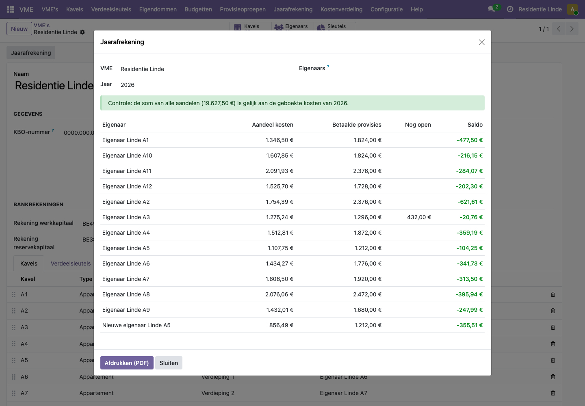
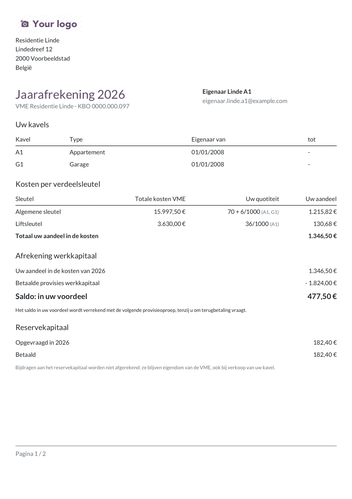

# Hoe lees en druk ik de jaarafrekening af?

De jaarafrekening zet per eigenaar de werkelijke kosten van het jaar tegenover de betaalde provisies werkkapitaal. Het verschil is het **saldo**: bij te betalen of in het voordeel van de eigenaar. Het reservekapitaal staat er apart op en wordt nooit afgerekend.

## Stappen

1. Open **VME > Jaarafrekening**, of open de VME en klik op de knop **Jaarafrekening** bovenaan.
2. Kies de **VME** en het **Jaar**.
3. Laat **Eigenaars** leeg voor alle eigenaars, of kies een of meer eigenaars als je maar een paar afrekeningen nodig hebt.
4. Kijk het voorbeeld na:
   - Bovenaan staat een **controle**. Groen betekent: de som van alle aandelen is gelijk aan de geboekte kosten van het jaar. Oranje betekent dat een of meer geboekte facturen nog niet verdeeld zijn; die worden dan genoemd.
   - Per eigenaar zie je het aandeel in de kosten, de betaalde provisies, wat nog open staat en het saldo. Een groen, negatief saldo is in het voordeel van de eigenaar; een rood, positief saldo is bij te betalen.
5. Klik op **Afdrukken (PDF)**. Je krijgt één PDF met een afrekening per eigenaar.

De eerste keer dat iemand in een VME een document afdrukt, vraagt Odoo om de opmaak te kiezen (logo, kleuren, lettertype). Klik op **Doorgaan** om de standaardopmaak te houden; je kunt ze later aanpassen in de instellingen.

## Wat staat er op de afrekening?

Per eigenaar:

- **Uw kavels**: de kavels van de eigenaar in dat jaar, met de datums van het eigendom.
- **Kosten per verdeelsleutel**: per sleutel de totale kosten van de VME, de quotiteit van de eigenaar en zijn aandeel.
- **Afrekening werkkapitaal**: het aandeel in de kosten min de betaalde provisies werkkapitaal, en het saldo. Is er een saldo te betalen, dan staat het rekeningnummer werkkapitaal erbij.
- **Reservekapitaal**: wat in het jaar is opgevraagd en betaald.
- **Detail van de kosten**: elke leveranciersfactuur met datum, leverancier, periode, sleutel, het totaal en het aandeel van de eigenaar. Was de eigenaar maar een deel van de periode eigenaar, dan staat erbij hoeveel dagen.

## Voorbeeld uit de demo

Na het laden van de demohistoriek heeft **Residentie Linde** een volledig jaar 2026: vier provisieoproepen, schoonmaak, liftonderhoud, verzekering en de jaarafrekening elektriciteit. (De schermafbeeldingen hierboven bevatten ook de dakgootfactuur uit het artikel [Een factuur verdelen](factuur-verdelen.md).)

- **Eigenaar Linde A1** (appartement A1 en garage G1) betaalde vier keer zijn provisie werkkapitaal en heeft een saldo in zijn voordeel.
- **Eigenaar Linde A3** betaalde de vierde oproep niet. Die staat in de kolom **Nog open** en wordt in het saldo **niet** verrekend: ze blijft gewoon verschuldigd. De PDF vermeldt welke factuur nog open staat.
- **A5** is op 1 juli verkocht. De verkoper en de koper krijgen elk een eigen afrekening. Een kost over het hele jaar, zoals de brandverzekering, betaalt de verkoper voor 181 dagen en de koper voor 184 dagen.

In **Hof ter Beuken** waren de werkelijke kosten (vooral gas) hoger dan het budget: daar heeft elke eigenaar die alles betaalde een saldo om bij te betalen.

## Veelgestelde vragen

**Welke facturen tellen mee in een jaar?**
Alle geboekte leveranciersfacturen met een factuurdatum in dat jaar, ook als hun kostperiode deels in een ander jaar valt. De kostperiode bepaalt alleen hoe de kost tussen verkoper en koper verdeeld wordt.

**Welke provisies tellen mee?**
De geboekte provisiefacturen met een factuurdatum in dat jaar. Alleen wat betaald is, wordt van de kosten afgetrokken.

**Waarom worden openstaande provisies niet verrekend in het saldo?**
Zo blijft de afrekening eenvoudig te volgen: het saldo gaat alleen over wat de eigenaar werkelijk betaalde. Wat nog open staat, blijft apart verschuldigd en staat duidelijk op de afrekening.

**Waarom wordt het reservekapitaal niet afgerekend?**
Het reservekapitaal is eigendom van de VME. Een eigenaar krijgt het niet terug, ook niet bij een verkoop.

**De controle bovenaan is oranje.**
Een of meer geboekte facturen zijn niet verdeeld, bijvoorbeeld omdat een regel geen verdeelsleutel had. Open die facturen, verdeel ze (zie [Een factuur verdelen](factuur-verdelen.md)) en open de jaarafrekening opnieuw.

**De PDF heeft geen opmaak of geen logo.**
Laat de beheerder nakijken of Odoo zichzelf kan bereiken om de opmaak te laden. Het logo stel je in bij de opmaak van documenten van de VME.

**Ik krijg "Geen kosten of provisies voor ... in ...".**
Er zijn voor die VME in dat jaar geen geboekte leveranciersfacturen en geen provisies. Controleer het jaar.
