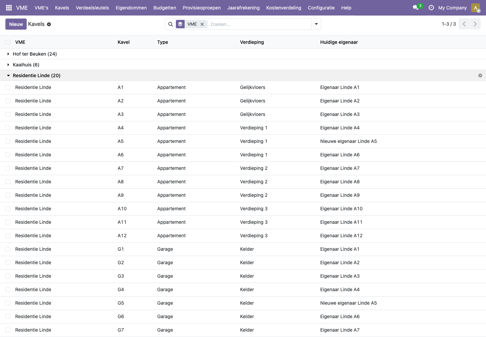
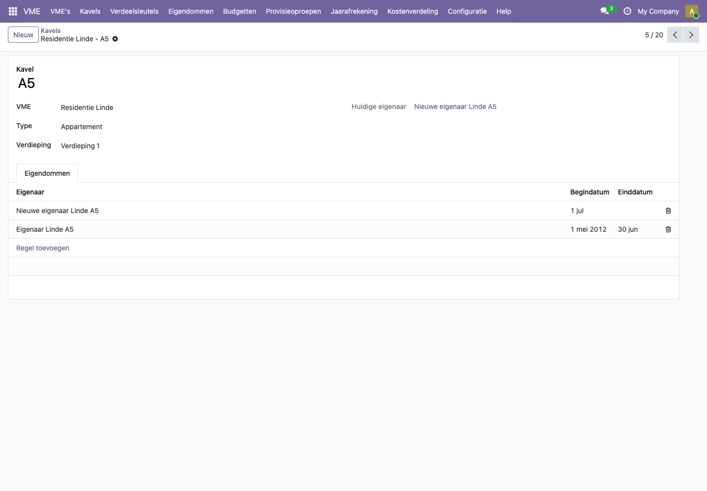
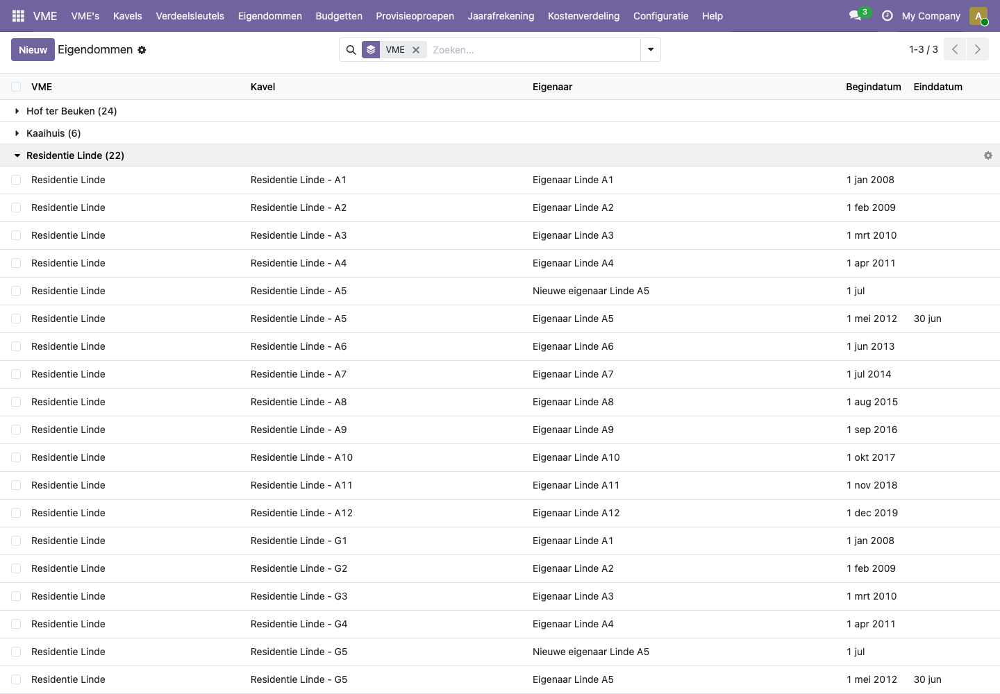

# Hoe beheer ik kavels en eigenaars, ook bij een verkoop?

Een kavel is een privatief deel van het gebouw: een appartement, een garage, een berging of een handelsruimte. Per kavel houd je bij wie eigenaar is, met een begindatum en eventueel een einddatum. Die datums bepalen wie welke kosten en provisies betaalt.

## Stappen

### Een kavel toevoegen

1. Open de VME (**VME > VME's**) en ga naar het tabblad **Kavels**.
2. Klik op **Regel toevoegen**.
3. Vul de naam van de kavel in (bijvoorbeeld A1 of G3), het type en de verdieping.
4. Sla de VME op.

Je vindt alle kavels van alle VME's ook in **VME > Kavels**, gegroepeerd per VME.

### Een eigenaar ingeven

1. Open de kavel en ga naar het tabblad **Eigendommen**.
2. Klik op **Regel toevoegen**.
3. Kies de eigenaar (of typ een nieuwe naam en kies **Maken en bewerken...**).
4. Vul de **Begindatum** in. Laat de **Einddatum** leeg zolang deze persoon eigenaar is.
5. Sla op.

Bezit één persoon meerdere kavels (bijvoorbeeld een appartement en een garage), geef dan voor elke kavel een eigendom in met dezelfde eigenaar.

### Een verkoop registreren

Bij een verkoop eindigt het eigendom van de verkoper de dag voor de akte, en begint dat van de koper op de dag van de akte.

1. Open de kavel en ga naar **Eigendommen**.
2. Vul bij de verkoper de **Einddatum** in: de dag vóór de overdracht.
3. Voeg een regel toe voor de koper met als **Begindatum** de dag van de overdracht.
4. Sla op.

Vanaf dan verdeelt het platform elke kost die over deze periode loopt pro rata: de verkoper betaalt de dagen tot en met de einddatum, de koper de dagen vanaf de begindatum. Provisieoproepen gaan naar wie eigenaar is op de factuurdatum van de oproep.

## Voorbeeld uit de demo

In **Residentie Linde** is appartement **A5** (met garage G5) verkocht. "Eigenaar Linde A5" was eigenaar van 1 mei 2012 tot 30 juni 2026, "Nieuwe eigenaar Linde A5" is eigenaar sinds 1 juli 2026. Het veld **Huidige eigenaar** toont de koper.

De elektriciteitsfactuur van november 2025 tot oktober 2026 wordt daardoor over 13 eigenaars verdeeld in plaats van 12: verkoper en koper van A5 dragen elk hun deel.

Alle eigendommen staan ook in **VME > Eigendommen**. Met de filter **Huidige eigenaars** zie je alleen wie vandaag eigenaar is.

## Veelgestelde vragen

**Ik krijg de melding "Kavel ... heeft al een eigenaar in deze periode".**
Een kavel heeft in het prototype maar één eigenaar tegelijk. Controleer of de einddatum van de vorige eigenaar vóór de begindatum van de nieuwe ligt. Bij een verkoop is dat de dag ervoor, niet dezelfde dag.

**Een kavel heeft twee eigenaars (mede-eigendom of vruchtgebruik). Hoe geef ik dat in?**
Dat kan nog niet. Geef voorlopig één eigenaar in, bijvoorbeeld de persoon die de facturen ontvangt.

**Ik krijg bij het verdelen van een factuur "Kavel ... heeft niet voor de hele kostperiode een eigenaar".**
Er zit een gat in de eigendommen van die kavel: een dag of periode zonder eigenaar. Vul de eigendommen aan zodat elke dag van de kostperiode gedekt is, en verdeel de factuur opnieuw.

**Kan ik een kavel verwijderen die al in een sleutel staat?**
Nee. Haal de kavel eerst uit alle verdeelsleutels en zorg dat die sleutels opnieuw kloppen.
