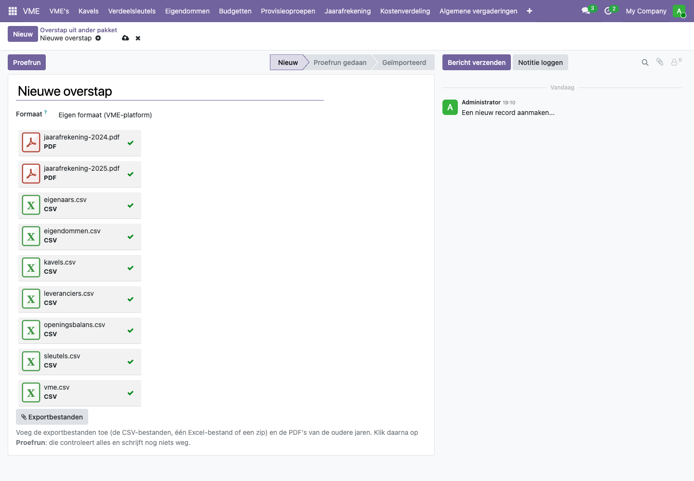
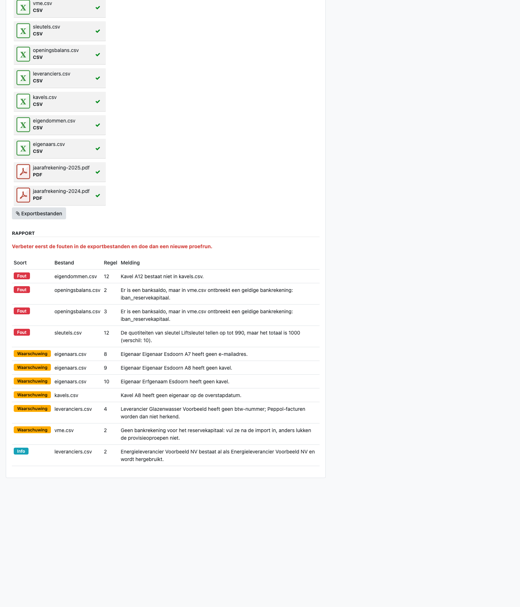
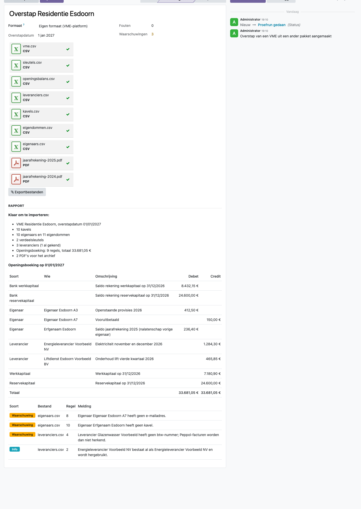
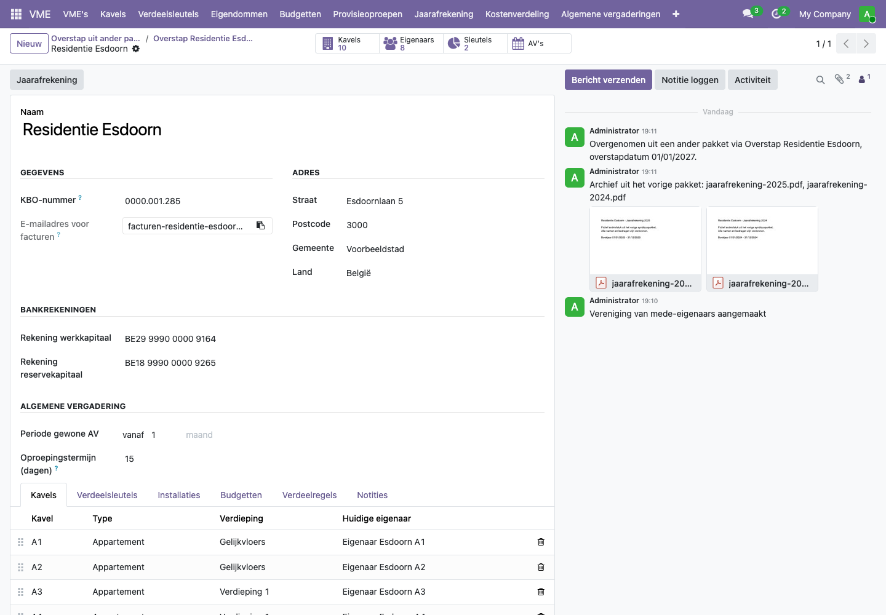

# Hoe neem ik een VME over uit een ander syndicuspakket?

Neem je als syndicus een gebouw over, of stap je met je kantoor over van een ander pakket? Dan hoef je niet alles opnieuw in te typen. Je haalt de gegevens uit het oude pakket als een reeks Excel- of CSV-bestanden en laadt ze op in het platform. Het platform neemt dan alles in één keer over: de VME, de kavels, de eigenaars met hun eigendomsdatums, de verdeelsleutels, de leveranciers en de stand van de rekeningen op de overstapdatum.

Je werkt altijd in twee stappen:

1. **De proefrun** controleert de bestanden en toont een rapport met fouten en waarschuwingen. Er wordt nog niets aangemaakt.
2. **De import** maakt alles aan. Die knop verschijnt pas als de proefrun geen fouten meer vindt.

Eén overstap is één VME. Voor een kantoor met veel gebouwen doe je dit per gebouw.

Krijg je een overdrachtspakket van een syndicus die ook dit platform gebruikt? Laad de zip zoals ze is op: ze bevat de bestanden in het juiste formaat (zie [Een VME overdragen aan een nieuwe syndicus](overdracht-syndicus.md)).

Neem je een gebouw over van een andere syndicus en heb je geen export, maar wel de basisakte en de notulen? Dan leest de AI die voor je: zie [Een gebouw overnemen met de basisakte en de notulen](overname-basisakte-ai.md).

## Wat heb ik nodig?

Een export uit het oude pakket, één bestand per onderwerp. Het platform kent een vast formaat. Je kunt de bestanden maken in Excel (één bestand met een tabblad per onderwerp) of als losse CSV-bestanden ("opslaan als CSV" in Excel).

| Bestand of tabblad | Wat erin staat |
| --- | --- |
| `vme` | Naam, KBO-nummer, adres, de twee rekeningnummers (werk- en reservekapitaal) en de **overstapdatum** |
| `kavels` | Elke kavel met type (appartement, garage, berging, handelsruimte, andere) en verdieping |
| `eigenaars` | Elke eigenaar met de code uit het oude pakket, naam, e-mail, telefoon en adres |
| `eigendommen` | Welke eigenaar welke kavel heeft, vanaf wanneer en (bij een verkoop) tot wanneer |
| `sleutels` | Per verdeelsleutel en per kavel de quotiteit, met de soort (algemeen, lift, verwarming, verbruik, andere) en het totaal |
| `leveranciers` | Leveranciers met btw-nummer, e-mail, rekeningnummer en de sleutel waarmee hun facturen verdeeld worden |
| `openingsbalans` | De stand op de overstapdatum: banksaldo's, werk- en reservekapitaal, wat elke eigenaar nog moet betalen of te goed heeft, en wat de VME nog aan leveranciers moet betalen |

Daarnaast laad je de **jaarafrekeningen van de vorige jaren als PDF** op. Die worden bij de VME bewaard. De boekhouding van die jaren zelf neem je niet over: het platform start met één openingsboeking op de overstapdatum.

De ontwikkelaars beschrijven elke kolom in detail. Geef die beschrijving aan wie de export uit het oude pakket maakt.

## Stappen

### 1. Een overstap aanmaken en de bestanden opladen

1. Ga naar **VME > Configuratie > Overstap uit ander pakket** en klik op **Nieuw**.
2. Klik op **Exportbestanden** en kies alle bestanden tegelijk: de CSV-bestanden (of het Excel-bestand) en de PDF's. Een zip-bestand mag ook.
3. Klik op **Proefrun**.

### 2. Het rapport van de proefrun lezen

Het rapport toont drie soorten meldingen:

- **Fout** (rood): dit moet je verbeteren voor je kunt importeren. Bijvoorbeeld een verdeelsleutel die niet optelt tot haar totaal, een kavel die niet bestaat, of een banksaldo zonder rekeningnummer.
- **Waarschuwing** (geel): importeren kan, maar kijk het na. Bijvoorbeeld een eigenaar zonder kavel, een kavel zonder eigenaar of een eigenaar zonder e-mailadres.
- **Info** (blauw): ter informatie. Bijvoorbeeld een leverancier die het platform al kent en die het hergebruikt.

Elke melding vermeldt het bestand en de regel, zodat je de fout meteen terugvindt.

Verbeter de fouten in de bestanden of in het oude pakket. Verwijder in de overstap de oude bestanden (kruisje), laad de verbeterde op en klik op **Proefrun opnieuw**.

### 3. Importeren

Vindt de proefrun geen fouten meer, dan toont het rapport wat er aangemaakt wordt en de openingsboeking regel per regel. Kijk de bedragen na tegen de laatste balans uit het oude pakket.

Klik op **Importeren** en bevestig. Het platform maakt dan:

- de VME, met haar eigen boekhouding en de twee bankrekeningen (bevestigd als jij dat mag);
- de kavels, eigenaars en eigendommen, ook die van vroegere eigenaars;
- de verdeelsleutels;
- de leveranciers, met een verdeelregel voor wie een sleutel heeft;
- de openingsboeking op de overstapdatum;
- het archief van PDF's, te vinden in het berichtenoverzicht rechts op de VME.

Met de knop **VME** bovenaan de overstap open je de nieuwe VME.

## Voorbeeld uit de demo

De demo bevat twee versies van de export van een verzonnen gebouw, **Residentie Esdoorn** (10 kavels, 10 eigenaars, een algemene sleutel en een liftsleutel, overstap op 1 januari 2027). Ze staan in de map `addons/vme_belgie/demo_data/migratie/` van het project:

- **`residentie-esdoorn-met-fouten`** heeft drie bewuste fouten:
  - de liftsleutel telt op tot 990 in plaats van 1.000;
  - een eigendom verwijst naar kavel A12, die niet bestaat;
  - het rekeningnummer van het reservekapitaal ontbreekt, terwijl er wel een saldo op staat.
- **`residentie-esdoorn`** is de verbeterde versie. Er blijven enkele waarschuwingen over:
  - een erfgenaam die nog een saldo heeft maar geen kavel meer;
  - een glazenwasser zonder btw-nummer;
  - een eigenaar zonder e-mailadres.

  Die kun je na de import aanvullen.

De openingsbalans van Esdoorn:

| | Debet | Credit |
| --- | ---: | ---: |
| Bank werkkapitaal | 8.432,15 | |
| Bank reservekapitaal | 24.600,00 | |
| Eigenaar A3 moet nog betalen | 412,50 | |
| Eigenaar A7 betaalde vooruit | | 150,00 |
| Erfgenaam moet nog betalen | 236,40 | |
| Energieleverancier nog te betalen | | 1.284,30 |
| Liftdienst nog te betalen | | 465,85 |
| Werkkapitaal | | 7.180,90 |
| Reservekapitaal | | 24.600,00 |
| **Totaal** | **33.681,05** | **33.681,05** |

## Veelgestelde vragen

**Wat is een goede overstapdatum?**
Bij voorkeur 1 januari, het begin van het boekjaar. Dan sluit het oude pakket het laatste jaar af met een volledige jaarafrekening, en begint het platform met een schone lei. Het kan ook op een andere datum, maar dan maakt het platform voor dat jaar maar een gedeeltelijke afrekening.

**Moet ik alle gebouwen tegelijk overzetten?**
Nee. We raden aan om eerst één VME een kwartaal lang in beide pakketten te beheren en de resultaten te vergelijken. Daarna volgen de andere VME's.

**De proefrun zegt dat de openingsbalans niet in evenwicht is.**
Tel na: banksaldo's en wat eigenaars nog moeten betalen staan langs de ene kant; werkkapitaal, reservekapitaal, wat de VME aan leveranciers moet en wat eigenaars vooruitbetaalden staan langs de andere kant. Het rapport toont het verschil. Meestal ontbreekt er een saldo of staat er een minteken verkeerd.

**Wat gebeurt er met eigenaars die al verkocht hebben?**
Die neem je op met een einddatum bij hun eigendom. Zo blijft de geschiedenis van de kavel bewaard, en kan een vroegere eigenaar met een openstaand saldo nog een betaling krijgen.

**Een leverancier bestaat al in het platform.**
Het platform herkent hem aan zijn btw-nummer en maakt hem niet opnieuw aan. Zijn verdeelregel komt er voor de nieuwe VME wel bij.

**Kan ik een import ongedaan maken?**
Niet met één knop. Doe daarom altijd eerst een proefrun en kijk de openingsboeking na. Is er toch iets misgegaan, vraag dan een beheerder om de VME en haar boekhouding te verwijderen voor je opnieuw begint.

**De bankrekeningen van de nieuwe VME zijn niet bevestigd.**
Alleen wie rekeningen mag bevestigen, krijgt ze meteen bevestigd. Anders toont de VME een gele melding; bevestig de rekeningen zoals in [Een VME aanmaken](vme-aanmaken.md).

**Mag ik echte gegevens van eigenaars opladen?**
Pas als de verwerkersovereenkomst met de syndicus getekend is. In de demo gebruik je alleen de verzonnen bestanden van Residentie Esdoorn.
