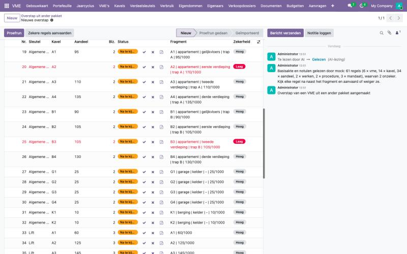
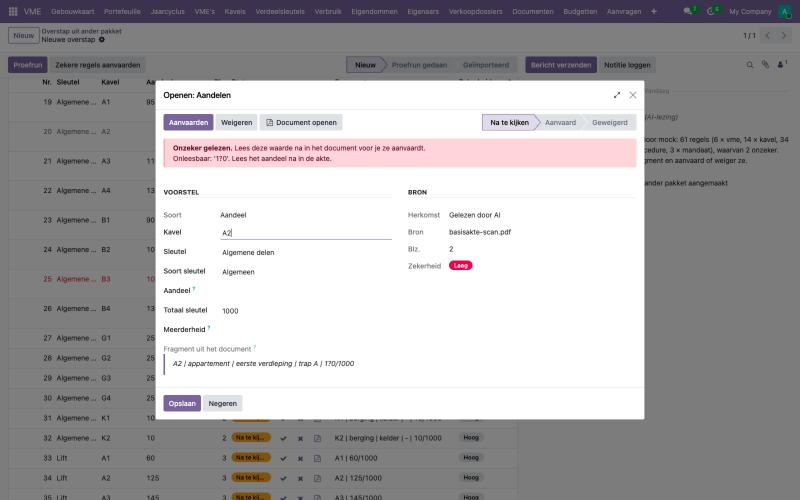

# Hoe neem ik een gebouw over met de basisakte en de notulen?

Neem je een gebouw over van een andere syndicus, dan krijg je meestal geen nette export, maar een stapel papier: de basisakte, de notulen van de laatste algemene vergaderingen en een lijst met eigenaars. Alles overtypen kost dagen. Het platform laat de AI die documenten lezen en stelt voor wat erin staat:

- uit de **basisakte**: de kavels (naam, type, verdieping), de aandelen in de algemene delen, de bijzondere sleutels (lift, verwarming, per trap of blok) en de gegevens van de VME;
- uit de **notulen**: beslissingen die nog uitgevoerd moeten worden (werken met hun geraamd bedrag), lopende procedures, mandaten van de raad van mede-eigendom en de commissaris, en sleutels die de AV anders besliste dan de basisakte.

Het blijft een **voorstel**. Jij kijkt elke regel na naast de zin uit het document waar de AI ze las. Er wordt niets aangemaakt tot je zelf importeert, en de gewone controles van de overstap blijven gelden: de aandelen van een sleutel moeten optellen tot het totaal, elke kavel moet een eigenaar hebben, enzovoort.

Dit artikel vult [Een VME overnemen uit een ander syndicuspakket](migratie.md) aan. Lees dat eerst als je de overstap nog niet kent.

## Wat heb ik nodig?

- De **basisakte** als PDF. Een scan mag ook. Hoe beter de scan, hoe minder je moet nalezen.
- De **notulen** van de laatste twee of drie algemene vergaderingen, als PDF.
- De **lijst met eigenaars** van de vorige syndicus, in het vaste formaat van de overstap: `eigenaars`, `eigendommen` en `openingsbalans`. Die staan niet in de akte.
- De **overstapdatum** en de twee **rekeningnummers** van de VME. Die staan ook niet in de akte: zet ze in een klein bestand `vme` (naam, rekeningen, overstapdatum), of voeg ze na het lezen zelf toe als regel op het tabblad **VME**.

## Stappen

### 1. De documenten toevoegen

1. Ga naar **VME > Configuratie > Overstap uit ander pakket** en klik op **Nieuw**.
2. Bij **Exportbestanden**: laad de lijst met eigenaars op (de CSV-bestanden of het Excel-bestand).
3. Bij **Basisakte en notulen**: laad de basisakte en de notulen op.
4. Sla op. Bovenaan staat nu **AI-lezing: Te lezen door AI**.

### 2. De AI laten lezen

De AI leest de documenten buiten het platform. In de demo start iemand van het team dat met één commando (zie de ontwikkelaarsdocumentatie). Na een minuut staat er **AI-lezing: Gelezen**, met in het berichtenoverzicht hoeveel regels er voorgesteld zijn en hoeveel daarvan onzeker zijn.

### 3. Het voorstel nakijken, regel per regel

Onder de documenten staan vier tabbladen:

| Tabblad | Wat je nakijkt |
| --- | --- |
| **VME** | Naam, KBO-nummer en adres, en waar ze vandaan komen |
| **Kavels** | Elke kavel met type en verdieping |
| **Aandelen en sleutels** | Per sleutel het aandeel van elke kavel, met het totaal van de sleutel |
| **Uit de notulen** | Werken die nog uitgevoerd moeten worden, lopende procedures en mandaten |

Elke regel toont de bladzijde en het **fragment**: de zin of de tabelrij uit het document waar de AI de waarde las. Klik op een regel om het fragment volledig te zien en de waarde te verbeteren. Met **Document openen** opent de PDF op die bladzijde.

Per regel kies je:

- **Aanvaarden** (vinkje): de waarde klopt.
- **Weigeren** (kruisje): de regel hoort er niet bij, bijvoorbeeld een oud mandaat dat al afgelopen is.

**Rode regels zijn onzeker gelezen.** De AI kon de waarde niet zeker lezen, bijvoorbeeld door een vlek of slechte scan. Het tabblad toont waarom ("Onleesbaar: '1?0'"). Lees het aandeel na in de akte, typ de juiste waarde en aanvaard dan.

Is alles wat zeker gelezen is ook nagekeken naast het fragment, dan kun je die regels in één keer aanvaarden met **Zekere regels aanvaarden**. Onzekere regels blijven altijd staan tot je ze één voor één behandelt.

### 4. Proefrun en importeren

Klik op **Proefrun**. Het rapport meldt:

- een **fout** als er nog regels na te kijken zijn, of als de aandelen van een sleutel niet optellen tot het totaal;
- een **waarschuwing** voor een onzekere regel die je aanvaardde zonder ze te verbeteren, of voor een sleutel die de AV aannam met minder dan vier vijfde van de stemmen;
- een **waarschuwing** voor elk verschil met een export uit het oude pakket, als je die ook oplaadde (de basisakte wint).

Zonder fouten verschijnt **Importeren**. Het platform maakt dan, naast wat een gewone overstap maakt:

- de verdeelsleutels uit de basisakte en de afwijkende sleutels uit de notulen;
- een **werkdossier** in voorbereiding voor elke beslissing die nog uitgevoerd moet worden, met het geraamde bedrag, de sleutel en de financiering;
- de **mandaten** van de raad van mede-eigendom en de commissaris;
- per **lopende procedure** een taak op de VME, en de procedures in het veld "Gerechtelijke procedures" van de VME (dat gaat mee naar de notaris bij een verkoop);
- de basisakte en de notulen in het archief van de VME.

## Voorbeeld uit de demo

**Residentie Wilg** (Wilgenlaan 21, Voorbeeldstad) is een verzonnen gebouw met twee trappen, acht appartementen, vier garages en twee bergingen. De documenten staan in `addons/vme_belgie/demo_data/migratie/residentie-wilg-documenten/`, de lijst met eigenaars in `residentie-wilg/`.

- `basisakte.pdf` is een leesbare akte van drie bladzijden met de tabel van de aandelen (1000/1000), de liftsleutel (alleen de appartementen) en een sleutel per trap.
- `basisakte-scan.pdf` is dezelfde akte als slechte scan. Over het aandeel van **A2** zit een vlek; het aandeel van **B3** leest de scanner als "1O5". De AI markeert beide rood. Aanvaard je A2 zonder aandeel, dan zegt de proefrun dat de algemene delen optellen tot 890 in plaats van 1000.
- `notulen-av-2025.pdf` beslist de renovatie van het dak van trap B (geraamd op 48.500 euro, uit het reservekapitaal). In 2026 is die nog niet gegund.
- `notulen-av-2026.pdf` beslist een nieuwe garagepoort (6.200 euro) met een eigen sleutel: alleen de vier garages, elk een gelijk deel, aangenomen met 4/5. Ze benoemt de raad (Eigenaar Wilg A3 voorzitter, B2 lid) en de commissaris (B4), en vermeldt twee lopende procedures.

## Veelgestelde vragen

**Mag de AI zelf iets aanmaken?**
Nee. De AI stelt alleen regels voor. Pas als jij elke regel aanvaardde of weigerde en op **Importeren** klikt, maakt het platform iets aan.

**Wat als de AI een aandeel verkeerd leest zonder het te melden?**
De proefrun telt elke sleutel na. Een verkeerd aandeel geeft bijna altijd een som die niet klopt. Kijk daarom ook de zekere regels na naast hun fragment voor je ze aanvaardt.

**Ik heb ook een export uit het oude pakket met kavels en sleutels.**
Laad ze gerust op. Het platform neemt de kavels en aandelen uit de basisakte, omdat die juridisch geldt, en toont elk verschil met de export als waarschuwing. Zo zie je meteen wat er in het oude pakket fout stond.

**Een sleutel uit de notulen werd niet met 4/5 aangenomen.**
Een verdeling die afwijkt van de basisakte vraagt in principe vier vijfde van de stemmen. Het platform waarschuwt, maar beslist niet: vraag na of de beslissing geldig is voor je de sleutel aanvaardt.

**Een mandaat van vorig jaar staat er ook bij.**
Weiger die regel. Het platform neemt alleen over wat je aanvaardt.

**Kan ik de documenten opnieuw laten lezen?**
Ja. Voeg een document toe of verwijder er een; de AI leest dan alles opnieuw. Een nieuwe lezing vervangt het hele voorstel van de AI, ook wat je al aanvaardde. Regels die je zelf toevoegde, blijven staan.

**Mag ik echte akten opladen?**
Pas als de verwerkersovereenkomst met de syndicus getekend is. In de demo gebruik je alleen de verzonnen documenten van Residentie Wilg.
