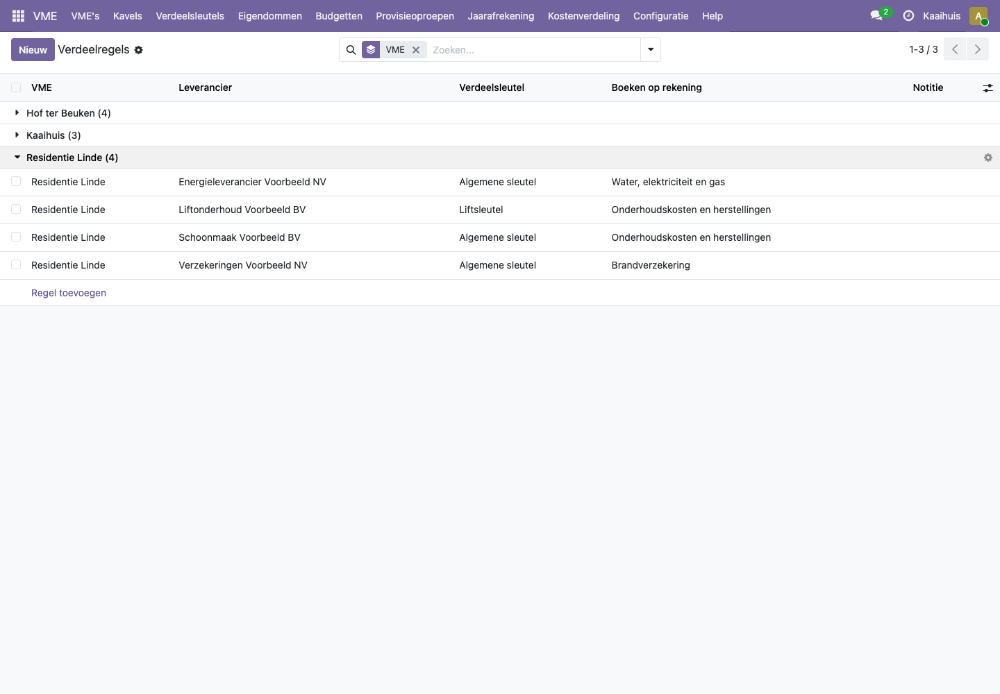
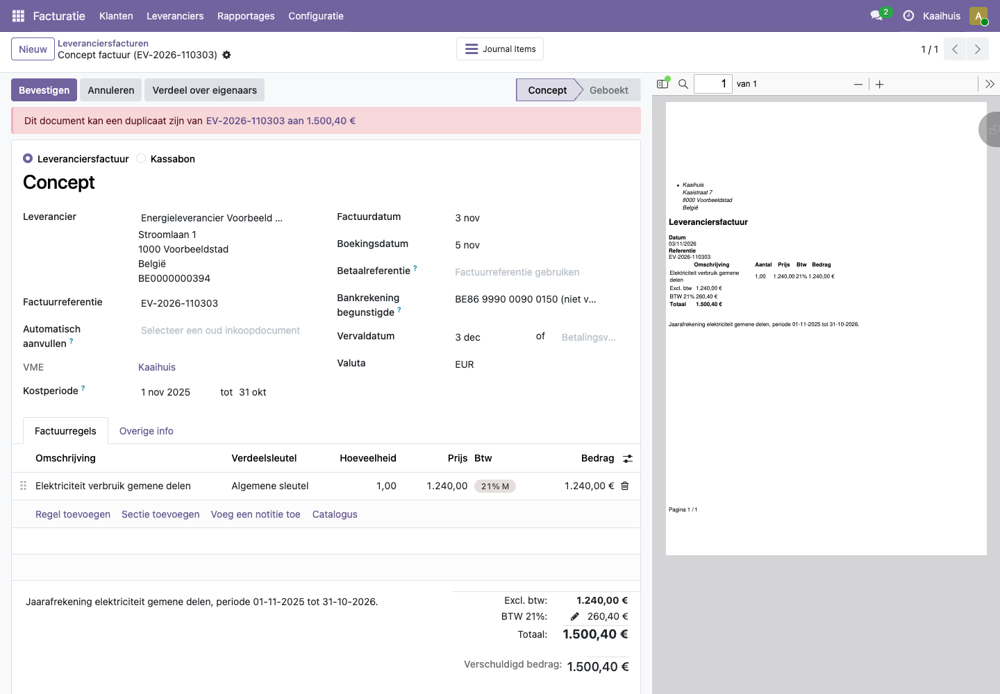
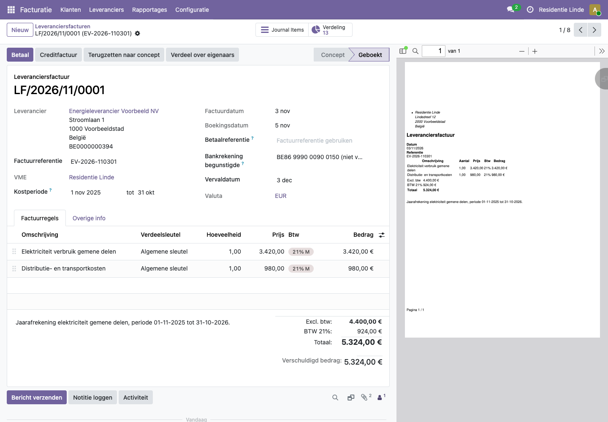

# Hoe laat ik facturen automatisch verdelen met verdeelregels en Peppol?

Veel leveranciers sturen elke maand of elk kwartaal een factuur die altijd op dezelfde manier verdeeld wordt: de energieleverancier volgens de algemene sleutel, de liftfirma volgens de liftsleutel. Met een **verdeelregel** leg je dat één keer vast per VME en per leverancier. Facturen van die leverancier krijgen dan vanzelf de juiste sleutel en worden bij het bevestigen automatisch verdeeld.

In België sturen leveranciers hun facturen steeds vaker elektronisch via **Peppol**. Zo'n factuur laad je op in Odoo, en de verdeelregel doet de rest.

## Stappen

### 1. Een verdeelregel maken

1. Open de VME en ga naar het tabblad **Verdeelregels**, of ga naar **VME > Configuratie > Verdeelregels** (alleen voor beheerders).
2. Klik op **Regel toevoegen** of **Nieuw**.
3. Kies de **Leverancier** en de **Verdeelsleutel**.
4. Kies eventueel bij **Boeken op rekening** de kostenrekening, bijvoorbeeld 612500 voor water, elektriciteit en gas. Laat je dit leeg, dan gebruikt Odoo de gewone kostenrekening 611000.
5. Sla op.

Per VME is er maximaal één regel per leverancier. Een regel die je tijdelijk niet wilt gebruiken, zet je op niet actief.

### 2. Een Peppol-factuur opladen

1. Kies rechtsboven de VME waarvoor de factuur is.
2. Ga naar **Facturatie > Leveranciers > Facturen**.
3. Klik op **Upload** en kies het bestand (een XML-bestand in Peppol-formaat).

Odoo maakt een conceptfactuur met de leverancier, de regels en de bedragen uit het bestand. Het platform vult zelf aan:

- de **VME**,
- de **Kostperiode** uit de factuur (de periode waarop de factuur slaat),
- per regel de **Verdeelsleutel** en de kostenrekening uit de verdeelregel.

4. Kijk de factuur na en klik op **Bevestigen**. De factuur wordt meteen verdeeld; in het logboek staat "Automatisch verdeeld over ... eigenaars".

## Voorbeeld uit de demo

In de demo heeft elke VME een verdeelregel voor **Energieleverancier Voorbeeld NV** (algemene sleutel, rekening 612500). Residentie Linde heeft er ook een voor **Liftonderhoud Voorbeeld BV** (liftsleutel). De demohistoriek voegt regels toe voor schoonmaak, verzekering en (in Hof ter Beuken) gas op de sleutel **Verwarming op verbruik** (zie [Verwarming of water op verbruik](verbruik-en-meterstanden.md)).

De jaarafrekening elektriciteit van Residentie Linde (factuur EV-2026-110301, 5.324,00 euro) slaat op 1 november 2025 tot 31 oktober 2026. Na het opladen en bevestigen is ze verdeeld over **13 eigenaars**: twaalf eigenaars plus de koper van A5, omdat A5 en G5 midden in die periode verkocht zijn.

De voorbeeldbestanden zelf staan in de map `addons/vme_belgie/demo_data/facturen/` van het project, één per VME.

## Veelgestelde vragen

**Ik heb zelf al een andere sleutel gekozen. Overschrijft de verdeelregel die?**
Nee. De regel vult alleen een lege sleutel in. Wat een medewerker zelf koos, blijft staan.

**Een factuur van een leverancier met regel werd niet automatisch verdeeld.**
Kijk in het logboek van de factuur. Meestal heeft een regel geen sleutel (bijvoorbeeld een regel die je zelf toevoegde na het opladen), of heeft een kavel geen eigenaar voor de hele kostperiode. De factuur blijft altijd geboekt; verdeel ze na het rechtzetten met **Verdeel over eigenaars**.

**Odoo meldt "Dit document kan een duplicaat zijn".**
Odoo vond al een factuur met dezelfde leverancier, referentie en bedrag. In de demo gebeurt dat als je een voorbeeldbestand oplaadt dat de demohistoriek al inlas. Bevestig zo'n factuur niet, maar verwijder het concept via het tandwiel naast de naam van de factuur en **Verwijderen**.

**Kan ik Peppol-facturen rechtstreeks laten binnenkomen, zonder opladen?**
Dat kan Odoo, maar niet met de verzonnen VME's van de demo: daarvoor moet elke VME echt geregistreerd zijn op het Peppol-netwerk.

**Werkt een verdeelregel ook voor facturen die ik met de hand ingeef?**
Ja. Zodra je de leverancier kiest, vult de regel de sleutel in op elke nieuwe factuurregel.
