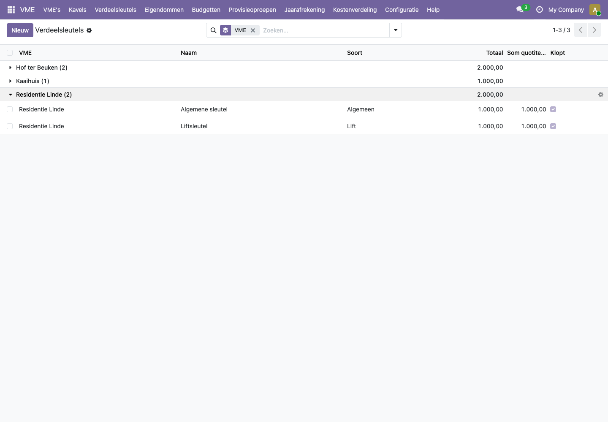
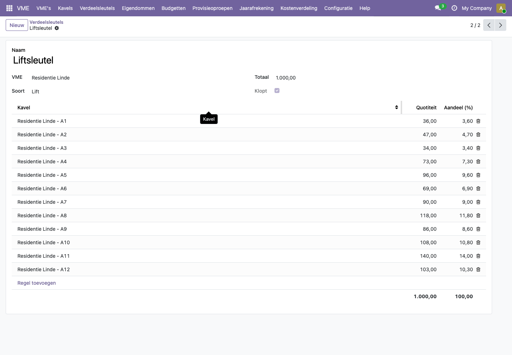
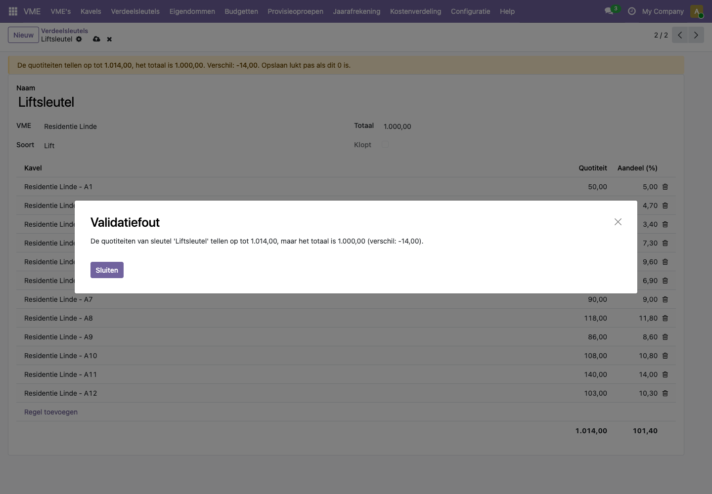

# Hoe maak ik een verdeelsleutel en vul ik de quotiteiten in?

Een verdeelsleutel zegt hoe een kost over de kavels wordt verdeeld. Elke kavel krijgt een quotiteit: een aandeel, meestal in duizendsten. De algemene sleutel volgt de quotiteiten uit de basisakte; daarnaast kan een gebouw bijvoorbeeld een liftsleutel of een verwarmingssleutel hebben.

## Stappen

1. Open **VME > Verdeelsleutels** en klik op **Nieuw**, of open de VME en ga naar het tabblad **Verdeelsleutels**.
2. Geef de sleutel een naam en kies de **VME** en de **Soort**: Algemeen, Lift, Verwarming, Op verbruik of Andere. Kies je **Op verbruik**, dan stel je ook het vaste deel en de tellers in: zie [Verwarming of water op verbruik](verbruik-en-meterstanden.md).
3. Vul het **Totaal** in, meestal 1.000.
4. Voeg per kavel een regel toe met de **Quotiteit**. Kavels die niet meebetalen (bijvoorbeeld garages in een liftsleutel) laat je weg.
5. Kijk onderaan de lijst: de som moet gelijk zijn aan het totaal. Het vinkje **Klopt** staat dan aan.
6. Sla op.

Tip: de kolom **Aandeel (%)** toont meteen welk percentage van elke kost een kavel betaalt.

In de lijst **VME > Verdeelsleutels** zie je per sleutel het totaal, de som van de quotiteiten en of de sleutel klopt.

## Voorbeeld uit de demo

**Residentie Linde** heeft twee sleutels. De **Algemene sleutel** telt alle 20 kavels; garages wegen er lichter in dan appartementen. De **Liftsleutel** telt alleen de 12 appartementen; hogere verdiepingen wegen zwaarder, het gelijkvloers het lichtst. Appartement A1 (gelijkvloers) heeft 36/1000 in de liftsleutel, appartement A11 (derde verdieping) 140/1000.

Als de quotiteiten niet optellen tot het totaal, toont het formulier bovenaan het verschil, en lukt opslaan niet. In dit voorbeeld kreeg A1 per vergissing 50 in plaats van 36: de som wordt 1.014 en het verschil -14.

Klik op **Sluiten**, verbeter de quotiteit of klik op het kruisje bovenaan om de wijziging te negeren.

## Veelgestelde vragen

**Waarom kan ik een sleutel niet opslaan als hij niet klopt?**
Een fout in een sleutel zou in elke factuur, elke provisieoproep en elke jaarafrekening doorlopen. Daarom controleert het platform de som bij elke wijziging.

**Moet het totaal 1.000 zijn?**
Nee. Gebruik het totaal uit de basisakte, bijvoorbeeld 10.000 of 100. Alleen de verhouding telt.

**Welke sleutel gebruikt het platform voor de provisieoproepen?**
De sleutel met soort **Algemeen**. Zorg dat elke VME er precies één heeft.

**Kan ik een quotiteit met cijfers na de komma ingeven?**
Ja, tot twee cijfers na de komma.

**Wat doet de soort "Op verbruik"?**
Voorlopig niets bijzonders: de sleutel werkt zoals elke andere. Verdelen volgens meterstanden komt later.
