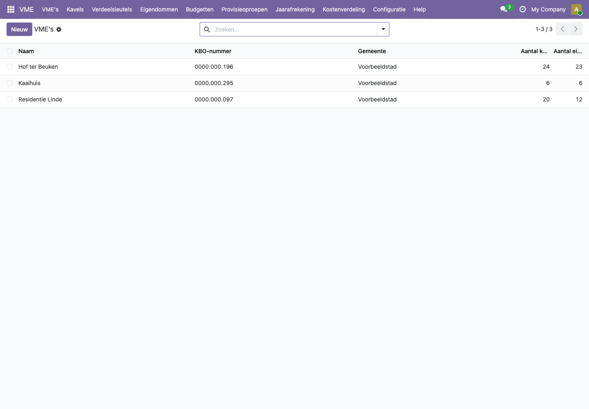
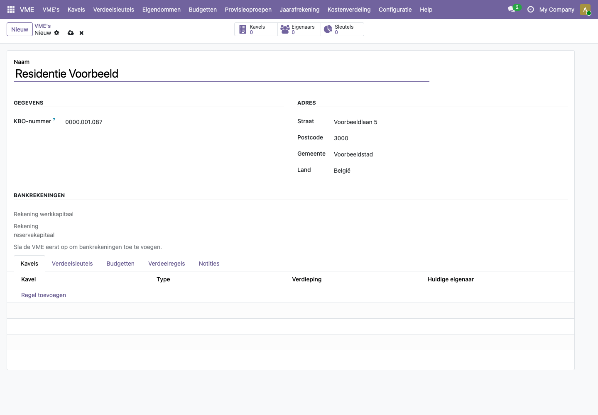
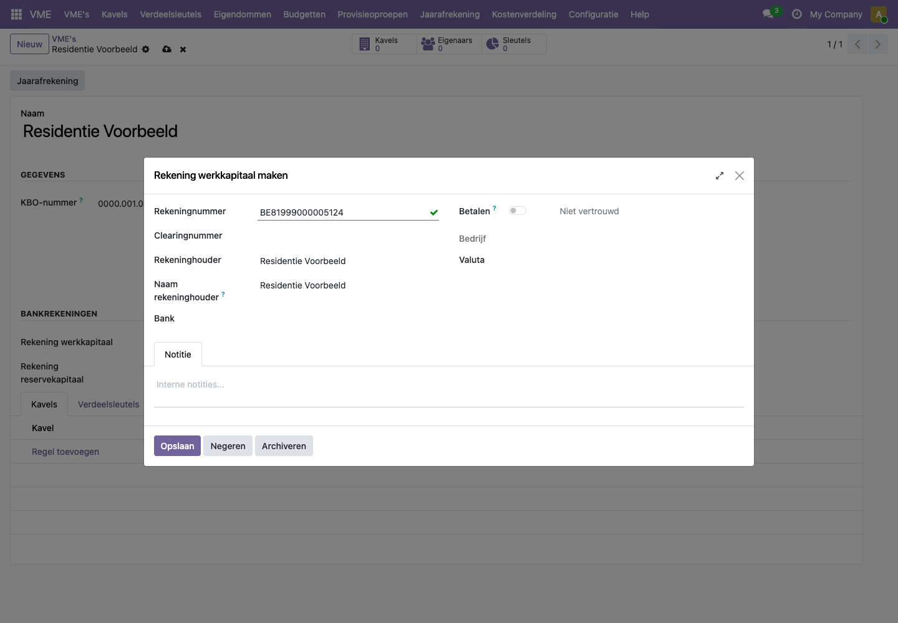
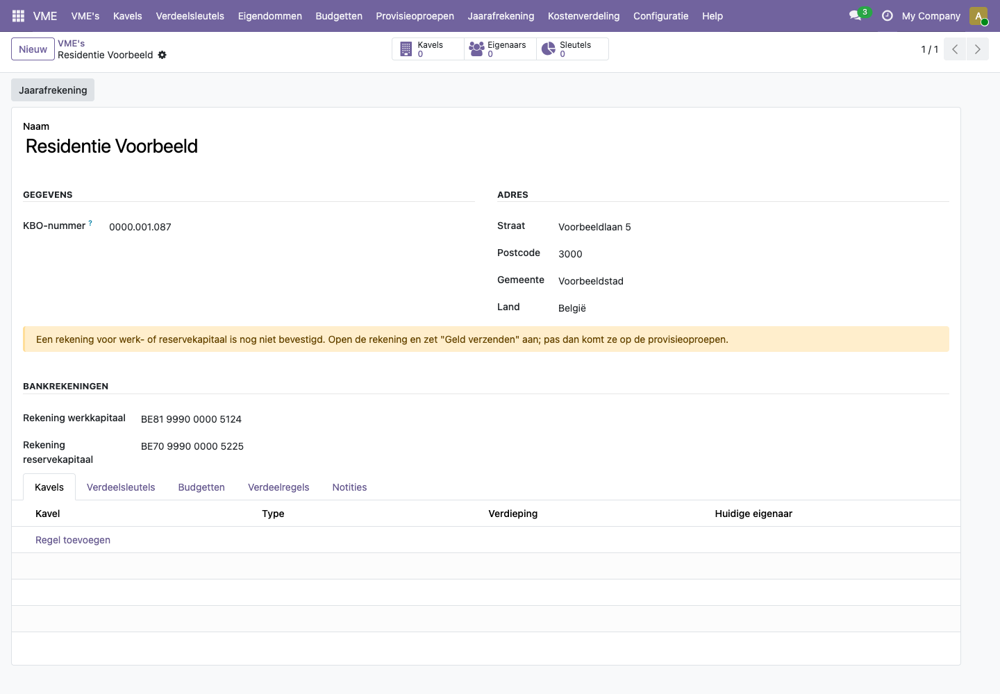
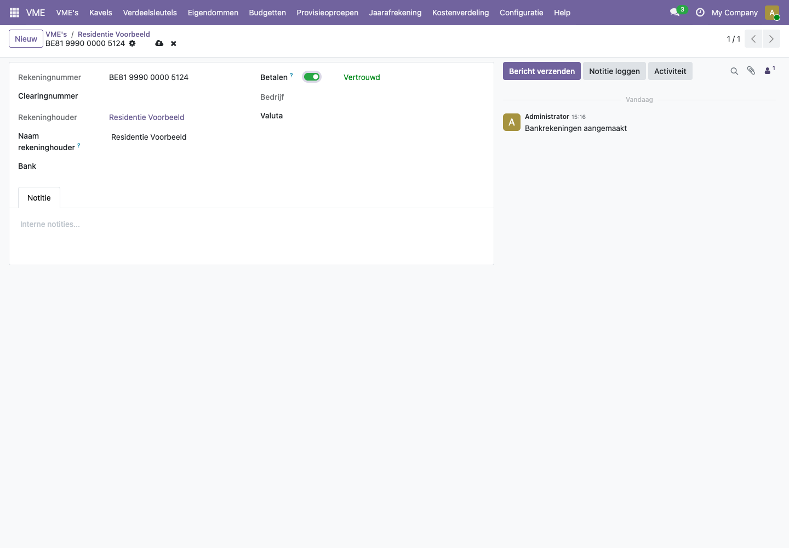
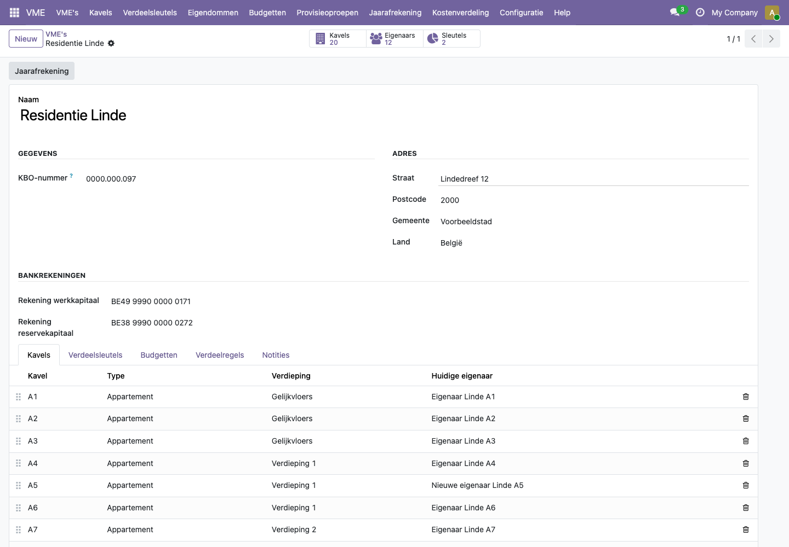

# Hoe maak ik een VME aan en bevestig ik de bankrekeningen?

Een VME is de vereniging van mede-eigenaars van één gebouw. In het platform krijgt elke VME automatisch een eigen boekhouding. Daarna geef je de twee bankrekeningen in: één voor het werkkapitaal en één voor het reservekapitaal.

## Stappen

### 1. De VME aanmaken

1. Open de app **VME** en klik op **VME's**. Je ziet alle VME's van het kantoor.

   

2. Klik op **Nieuw**.
3. Vul de naam, het KBO-nummer en het adres in. Kies bij **Land** voor België.
4. Klik op het wolkje (opslaan).

Bij het opslaan maakt het platform de boekhouding van de VME aan. Dat duurt enkele seconden.

### 2. De bankrekeningen ingeven

Pas als de VME opgeslagen is, kun je bankrekeningen toevoegen.

1. Typ bij **Rekening werkkapitaal** het rekeningnummer (IBAN).
2. Klik op **Maken en bewerken...**. Het venster toont het rekeningnummer en de VME als rekeninghouder.
3. Klik op **Opslaan**.
4. Doe hetzelfde voor **Rekening reservekapitaal**, met een ander rekeningnummer.
5. Sla de VME op.

Na het opslaan verschijnt een gele melding: de rekeningen zijn nog niet bevestigd.

### 3. De bankrekeningen bevestigen

Odoo zet een rekening van de VME pas op een factuur als een medewerker ze uitdrukkelijk heeft bevestigd. Zo kan niemand ongemerkt een verkeerd rekeningnummer op de provisieoproepen zetten.

1. Ga met de muis over **Rekening werkkapitaal** en klik op het pijltje rechts (**Interne link**).
2. Zet de schakelaar **Betalen** aan. Ernaast verschijnt **Vertrouwd**.
3. Sla de rekening op en ga terug naar de VME.
4. Doe hetzelfde voor de rekening reservekapitaal.

Zijn beide rekeningen bevestigd, dan verdwijnt de gele melding.

## Voorbeeld uit de demo

**Residentie Linde** (KBO 0000.000.097, Lindedreef 12, 2000 Voorbeeldstad) heeft twee bevestigde rekeningen: BE49 9990 0000 0171 voor het werkkapitaal en BE38 9990 0000 0272 voor het reservekapitaal. Bovenaan het formulier zie je meteen het aantal kavels, eigenaars en sleutels.

## Veelgestelde vragen

**Waarom moet ik een rekening bevestigen?**
Een provisieoproep vraagt eigenaars geld te storten. Odoo zet daarom alleen rekeningen op een factuur die iemand met de juiste rechten heeft nagekeken. Zonder bevestiging weigert het platform de provisieoproep met een duidelijke melding.

**De melding spreekt over "Geld verzenden", maar ik zie die schakelaar niet.**
In de Nederlandse versie van Odoo heet die schakelaar **Betalen**. Het is dezelfde instelling.

**Mag ik werkkapitaal en reservekapitaal op dezelfde rekening zetten?**
Nee. De wet vraagt aparte rekeningen, en het platform weigert op te slaan als beide velden hetzelfde rekeningnummer hebben.

**Het KBO-nummer wordt geweigerd.**
Een KBO-nummer heeft tien cijfers en een controlegetal. Typ het met of zonder puntjes, bijvoorbeeld 0123.456.749.

**Na het opslaan is het veld Land leeg.**
Dat gebeurt als je Land leeg liet bij het aanmaken. Vul België in en sla opnieuw op.

**Ik kan geen bankrekening ingeven.**
Sla de VME eerst op. Zolang ze niet opgeslagen is, staat onder **Bankrekeningen** de uitleg "Sla de VME eerst op om bankrekeningen toe te voegen."
