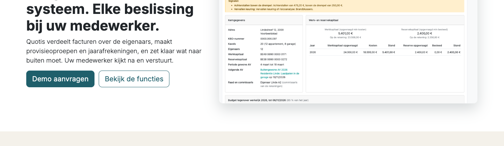

# De website en inloggen

Het platform heeft een eigen website met uitleg over het product, een pagina voor eigenaars, prijzen en een formulier om een demo aan te vragen. Bovenaan staat één knop **Inloggen** voor iedereen: medewerkers van het kantoor en eigenaars of huurders.

> De productnaam **Quotis** is een werktitel. Die naam bestaat al en wordt nog vervangen.

## Hoe log ik in als medewerker?

1. Ga naar de website en klik bovenaan rechts op **Inloggen**.
2. Kies **Medewerker van de syndicus**.
3. Vul uw e-mailadres en wachtwoord in en klik op **Login**.

U komt meteen in de app **VME**, op de lijst van de VME's.

## Hoe logt een eigenaar of huurder in?

1. De eigenaar klikt op **Inloggen** en kiest **Eigenaar of huurder**.
2. Hij vult het e-mailadres en het wachtwoord in dat hij bij zijn uitnodiging koos.

Hij komt in zijn eigenaarsportaal (zie [Het eigenaarsportaal](eigenaarsportaal.md)). Een login geeft u zelf, via **Portaaltoegang** in het register van eigenaars.

Op een gsm staat **Inloggen** in het menu (de drie streepjes bovenaan rechts). Er is ook een pagina **Inloggen** met de twee keuzes onder elkaar; de link staat onderaan op elke pagina.

## Wat als iemand de verkeerde knop kiest?

Dat is geen probleem. Na het inloggen kijkt het platform wie er inlogt: een medewerker komt altijd in de app VME, een eigenaar of huurder altijd in zijn portaal. Een eigenaar kan dus nooit in de beheeromgeving terechtkomen.

## Wat gebeurt er met een demo-aanvraag?

Een bezoeker vult op **Prijzen** of **Contact** het formulier in: naam, kantoor, e-mail, telefoon, aantal VME's en wat hij wil zien. Daarna ziet hij een bedankpagina.

- De aanvraag komt als **lead** in de app **CRM**, onder **CRM > Leads** (of **Pijplijn**). De titel is *Demo-aanvraag via de website*; het aantal VME's staat in de interne notities.
- De lead krijgt geen verkoper en geen team. Niemand krijgt automatisch een mail, ook de bezoeker niet. Een medewerker neemt de lead op en neemt zelf contact op.

## Kan ik de teksten van de website aanpassen?

Ja. Ga ingelogd naar de website en klik op **Bewerken** bovenaan rechts. De pagina's zijn gemaakt met de gewone blokken van Odoo Website; u wijzigt teksten, afbeeldingen en knoppen rechtstreeks op de pagina.

**Voorbeeld in de demo:** open de website, klik op **Inloggen > Eigenaar of huurder** en log in met `eigenaar.linde.a1@example.com`, wachtwoord `portaal-demo`. U komt in het portaal van Eigenaar Linde A1. Log uit en log via dezelfde knop in als `admin` / `admin`: u komt toch in de app VME.

## Veelgestelde vragen

**Waarom ziet een eigenaar in zijn portaal het menu van de website?**
Het portaal gebruikt dezelfde opmaak als de website. De knoppen van de website (Functies, Prijzen) blijven zichtbaar; de knop **Demo aanvragen** verdwijnt na het inloggen.

**Kan een eigenaar zich zelf registreren?**
Nee. Alleen u geeft toegang, via **Portaaltoegang**.

**Een bezoeker zegt dat hij geen bevestiging kreeg.**
Dat klopt: het formulier verstuurt niets. Hij ziet alleen de bedankpagina. Neem contact op via de lead in CRM.

**Wat gebeurt er met de oude pagina "Contacteer ons" van Odoo?**
Die stuurt bezoekers door naar **Contact**. Het formulier van Odoo zelf zou een mail versturen, dat van het platform niet.
